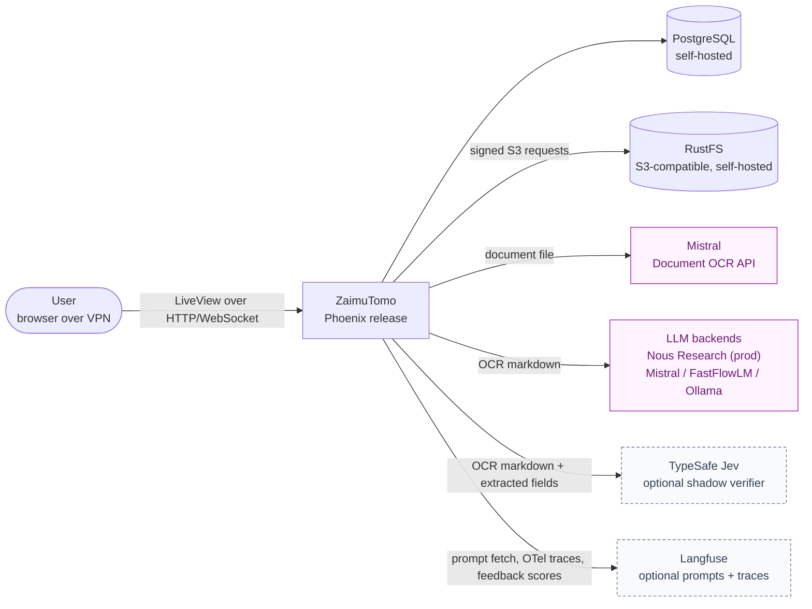
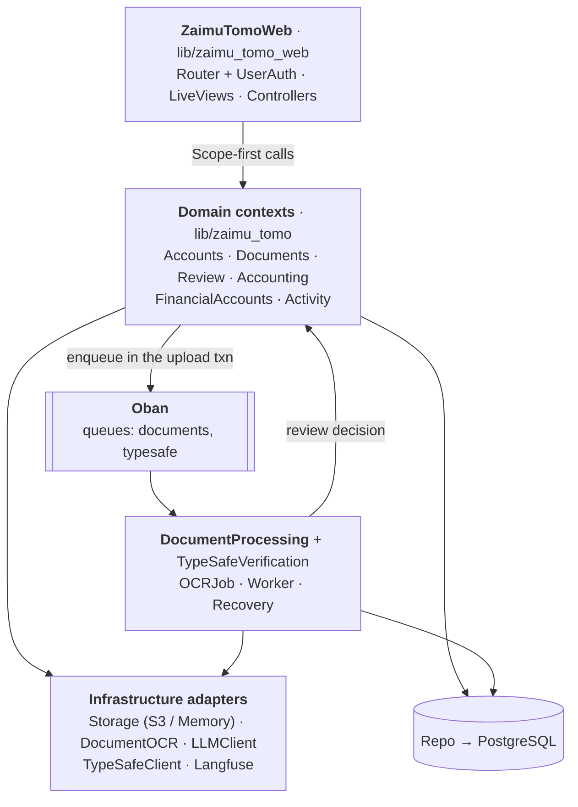
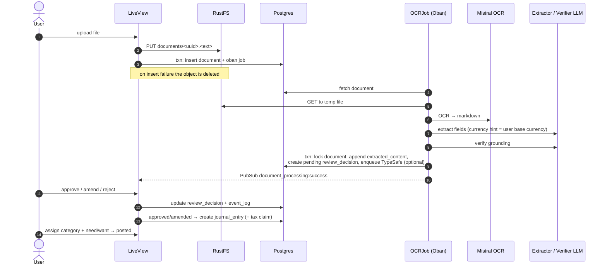
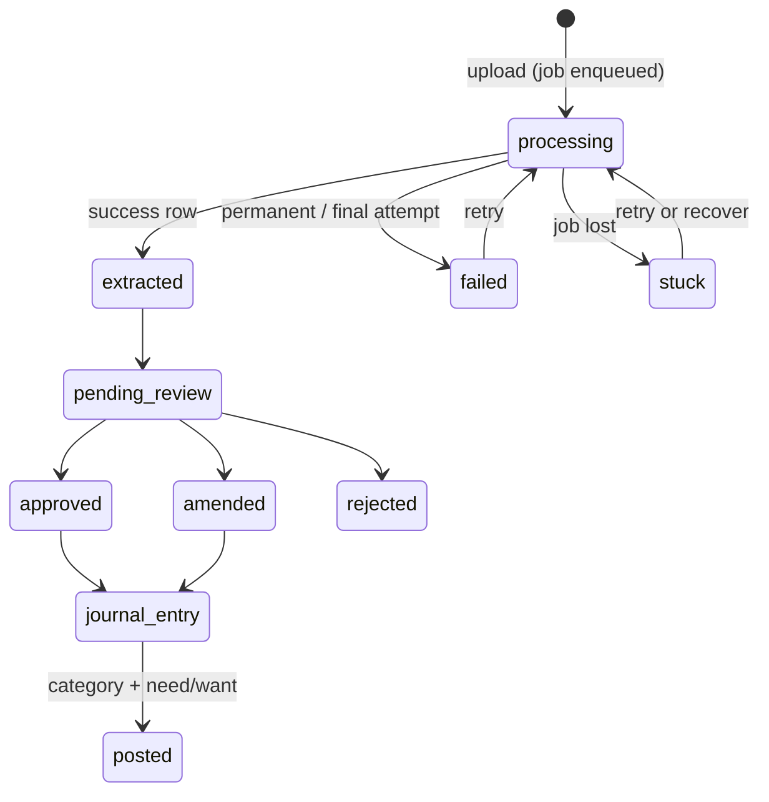
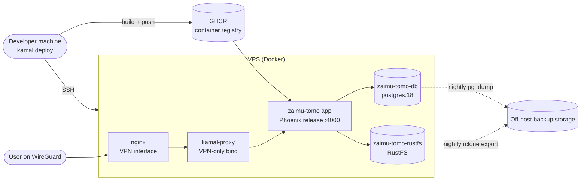
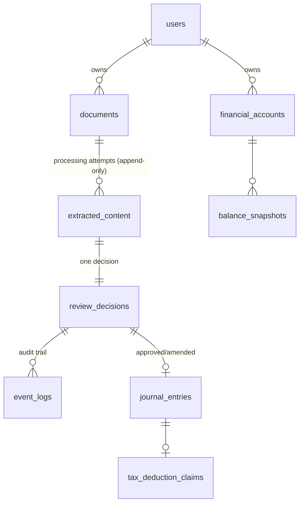

# ZaimuTomo architecture

A lightweight [arc42](https://arc42.org) description of ZaimuTomo, read top-down:
what the system is for, what it talks to, how it is built, how it runs, and why
it looks the way it does. Infrastructure and day-2 operations have their own
pages: [deployment.md](deployment.md), [operations.md](operations.md), and
[configuration.md](configuration.md).

> Keep this file true. When a change alters a context, a flow, a table, a queue,
> an external service, or a deployment unit, update the matching section in the
> same commit. See [docs/README.md](README.md#keeping-the-docs-current).

---

## 1. Introduction and goals

ZaimuTomo (財務の友, "finance friend") is a personal-finance and bookkeeping web
application. The user uploads invoices and receipts. The system reads them with
OCR and LLMs, and the user approves the result before anything enters the books.

Main capabilities:

| Capability | Summary |
|---|---|
| Document intake | Upload invoices and receipts (PDF, images), stored privately in S3-compatible object storage. |
| AI extraction | OCR to markdown (Mistral), LLM extraction of invoice fields, and a second LLM pass that checks the fields are grounded in the document. |
| Human review | Approve, amend, or reject each extraction. Nothing is booked without sign-off. |
| Bookkeeping | An approved or amended invoice becomes a journal entry. The user then assigns a category and a need/want label, and can mark tax deductibility. |
| Wealth tracking | Financial accounts (cash, savings, investment) with balance snapshots over time. |
| Insight | Dashboard, activity feed, and monthly and year-to-date spending views. |

### Quality goals

| Priority | Goal | What it means here |
|---|---|---|
| 1 | **Correct books** | AI output is a proposal. Only human-reviewed data becomes a journal entry, and every review decision is logged. |
| 2 | **No lost work** | An accepted upload always gets processed or ends in a visible failure the user can retry. Jobs survive restarts and deploys. |
| 3 | **Privacy** | Financial documents stay on self-hosted infrastructure. The app is reachable only over a VPN. Third parties receive only what they need (OCR and LLM calls). |
| 4 | **Low operating cost and simplicity** | One Phoenix monolith, one Postgres, one object store, on one VPS. No separate job broker or microservices. |
| 5 | **Swappable AI** | OCR, extractor, and verifier backends are selected by configuration, so models can change without code changes. |

### Stakeholders

| Who | Expectation |
|---|---|
| Owner/operator (single developer and primary user) | Understands and can operate the system a year from now from these docs. |
| AI coding agents | Find architecture and conventions quickly, and keep these docs current (see `AGENTS.md`). |

---

## 2. Constraints

- **Stack:** Elixir 1.19 / OTP 28, Phoenix 1.8 with LiveView, Ecto with PostgreSQL 18, Tailwind v4, and esbuild. HTTP calls go through `Req`.
- **Single deployable:** one OTP release in one container, deployed with Kamal 2 to a single VPS.
- **Network:** the app is not exposed on the public internet. Users reach it over WireGuard, and only SSH is public.
- **Background work:** Oban OSS (no Pro features). The queue lives in the same Postgres database.
- **Object storage:** must stay provider-neutral (generic `S3_*` config and SigV4 over `Req`). RustFS is self-hosted today.
- **OCR provider:** Mistral Document OCR is the only OCR implementation.
- **License:** MIT; the source is public. Secrets and host details never go into git.

---

## 3. Context and scope

| Neighbour | Direction | Data that leaves the system | Required? |
|---|---|---|---|
| Browser | in | — | yes |
| PostgreSQL | internal | all relational data and the Oban job table | yes |
| RustFS (S3 API) | internal | original document bytes | yes |
| Mistral OCR | out | the uploaded document file | yes, to process documents |
| Extractor and verifier LLM | out | OCR markdown and extracted fields | yes. In local dev, FLM or Ollama keep it on the machine. Prod sends it to a third-party inference provider (Nous Research by default). |
| TypeSafe | out | OCR markdown and extracted fields | no. Enabled by `TYPESAFE_API_KEY`. |
| Langfuse | out | prompts, traces, and user feedback scores | no. Enabled by `LANGFUSE_*` keys. Local prompt fallbacks exist. |

The browser never talks to object storage or AI providers directly. ZaimuTomo
mediates every access.

---

## 4. Solution strategy

- **Modular monolith.** Phoenix contexts (`lib/zaimu_tomo/*`) own domain logic. LiveViews (`lib/zaimu_tomo_web/live/*`) are thin, and every user-facing query is scoped by `%Accounts.Scope{}`.
- **Durable, transactional jobs.** A document row and its OCR job are inserted in the same Postgres transaction (`Ecto.Multi` plus `Oban.insert`), so an upload cannot exist without its job. Oban retries transient failures and Lifeline rescues jobs orphaned by crashes or deploys.
- **Append-only processing history.** Every terminal processing attempt appends an `extracted_content` row. Retries supersede earlier rows instead of mutating them.
- **Human in the loop.** AI output feeds a review queue. Journal entries are created only from approved or amended decisions, and decisions are audited in `event_logs`.
- **Defence against AI errors.** A second "verifier" LLM checks grounding. An optional independent verifier (TypeSafe) runs in *shadow mode* to gather comparison data without affecting results.
- **Configuration over code for providers.** S3 endpoint, LLM backend, and model per role are all runtime environment variables.
- **Self-hosted by default.** Postgres and RustFS run beside the app as Kamal accessories on the same host.
- **Real-time UI.** Phoenix PubSub broadcasts processing and review events to LiveViews.

---

## 5. Building block view

### Level 1 — the release

| Building block | Path | Responsibility |
|---|---|---|
| `Accounts` | `lib/zaimu_tomo/accounts*` | Users, sessions and tokens (phx.gen.auth), `Scope`, and per-user settings (display name, base currency). |
| `Documents` | `lib/zaimu_tomo/documents*` | Scoped document CRUD. Creates a document and its OCR job atomically, and deletes the object after the row is deleted. |
| `DocumentProcessing` | `lib/zaimu_tomo/document_processing*` | OCR → extraction → verification pipeline (`OCRJob`, `Worker`), processing state, retry, stuck-document `Recovery`, and `ErrorClassification`. |
| `TypeSafeVerification` | `lib/zaimu_tomo/type_safe_verification*` | Optional shadow verification job on the `typesafe` queue. |
| `Review` | `lib/zaimu_tomo/review*` | One `ReviewDecision` per extraction (pending → approved / amended / rejected / failed), the `EventLog` audit trail, and Langfuse feedback scores. |
| `Accounting` | `lib/zaimu_tomo/accounting*` | Journal entries from decisions, posting (category plus need/want), tax deduction claims, and spending aggregates. |
| `FinancialAccounts` | `lib/zaimu_tomo/financial_accounts*` | Accounts and balance snapshots, net worth by currency. |
| `Activity` | `lib/zaimu_tomo/activity.ex` | A read model assembling each document's current workflow state for the feeds. |
| `Storage` | `lib/zaimu_tomo/storage*` | Provider-neutral facade (`put/get/head/delete/read`) with S3 and in-memory adapters, plus migration and verification tooling. |
| `LLMClient` | `lib/zaimu_tomo/llm_client.ex` | Per-role (extractor and verifier) backend and model resolution through ReqLLM, and response parsing and validation. |
| `Langfuse` | `lib/zaimu_tomo/langfuse.ex` | Prompt fetch (with built-in local fallbacks), OpenTelemetry spans, and feedback scores. |
| `Release` | `lib/zaimu_tomo/release.ex`, `rel/overlays/bin/*` | Release-time commands: migrate, rollback, S3 migration and verification, and stuck-document recovery. |

### Level 2 — document processing

| Module | Role |
|---|---|
| `DocumentProcessing.OCRJob` | Oban worker (`documents` queue, 5 attempts, 10-minute timeout, unique per `document_id` while live). Decides retry, failure recording, or cancellation. |
| `DocumentProcessing.Worker` | One attempt: download the object to a temp file → `DocumentOCR` → `LLMClient.extract_invoice` → `LLMClient.verify_extraction` → persist. Persists success only. |
| `DocumentProcessing.ErrorClassification` | Classifies each error as `:transient` or `:permanent`, and produces bounded, body-free summaries. |
| `DocumentProcessing.Recovery` | Finds documents with no extraction and no live job, and re-enqueues them. |
| `ObanFailureLogger` | Telemetry handler that logs failed attempts without payloads. |

---

## 6. Runtime view

### 6.1 Upload → extraction → review → journal entry

### 6.2 Failure, retry and recovery

- **Transient error** (timeouts, 408, 429, 5xx, transport errors) on a non-final attempt: the job returns `{:error, summary}` and **persists nothing**. Oban backs off and retries.
- **Permanent error**, or a transient error on the final attempt (5): the job appends one `failed` `extracted_content` row and a `failed` review decision, broadcasts `document_processing:failed`, and completes.
- **Concurrency safety:** every terminal write locks the document row and checks that the latest extraction is still the one expected when the job was enqueued. Otherwise it cancels with `:already_processed`.
- **Crash or deploy mid-run:** `Oban.Lifeline` moves `executing` jobs back after 30 minutes.
- **User retry:** `DocumentProcessing.retry_document/2` re-enqueues documents in the `:failed` or `:stuck` state. The new run supersedes the old row, which stays as history.
- **Operator recovery:** `bin/recover_stuck_documents` (see [operations.md](operations.md#stuck-documents)).

### 6.3 TypeSafe shadow verification (optional)

When `TYPESAFE_API_KEY` is set, the success transaction also enqueues a
`TypeSafeVerification.Worker` job on the `typesafe` queue, isolated by a
savepoint so an enqueue failure never rolls back the extraction. The job re-reads
the OCR markdown from the stored row; job args never contain financial text. It
writes per-field error probabilities to
`extracted_content.analysis.verification.typesafe_shadow` and never changes the
authoritative verification result. It is fail-open: provider errors are recorded
on the row and the job completes.

---

## 7. Deployment view

| Environment | How it runs |
|---|---|
| Local dev | `docker compose` for Postgres and RustFS, then `mix phx.server`. Local LLMs (FastFlowLM or Ollama) or cloud backends. |
| Test / CI | GitHub Actions (`.github/workflows/ci.yml`): Postgres service, `mix compile --warnings-as-errors`, `mix test`. The in-memory storage adapter and Oban `testing: :manual` are used. RustFS integration tests are opt-in (`RUN_INTEGRATION=true`, Testcontainers). |
| Amp orb | `.agents/setup` and `.agents/resume` prepare a disposable dev sandbox (orb only, never production). |
| Production | Kamal 2 on a single VPS, as above. Details: [deployment.md](deployment.md). |

---

## 8. Crosscutting concepts

### Data model

- `documents` stores `filename` (original name) and `object_key` (`documents/<uuid>.<ext>`). The bytes live only in object storage.
- `extracted_content` holds `extracted_data` (an embedded schema), `raw_llm_response`, an `analysis` map (verification and TypeSafe shadow results), `status` (`success` or `failed`), `error_details`, and the Langfuse `trace_id`.
- Money is stored in integer cents with an ISO currency code. Each user has a `base_currency` (default CHF), which is snapshotted into each OCR job as the currency hint.
- `oban_jobs` lives in the same database. Finished jobs are pruned after 7 days.
- Deleting a document that has a posted journal entry is blocked by a foreign key.

### Multi-tenancy and authorization

Every context function takes `%Accounts.Scope{}` first and filters by
`scope.user.id`. Routes requiring login live in `live_session :require_authenticated_user`.
Unscoped functions exist only for maintenance tasks (storage verification,
stuck recovery) and say so in their docs.

### Background jobs (Oban)

| Queue | Worker | Concurrency (env) | Attempts | Notes |
|---|---|---|---|---|
| `documents` | `DocumentProcessing.OCRJob` | `OBAN_DOCUMENTS_CONCURRENCY` (2) | 5 | Unique per document while live. 10-minute timeout. |
| `typesafe` | `TypeSafeVerification.Worker` | `TYPESAFE_MAX_CONCURRENCY` (2) | 3 | Fail-open shadow run. |

Plugins: `Oban.Pruner` (7 days) and `Oban.Lifeline` (30 minutes, which must exceed
the OCR timeout). Rules: job args are self-contained commands resolved at
enqueue time, and they never carry document text or provider payloads.

### AI pipeline configuration

OCR always uses Mistral. The extractor and verifier each take an explicit
`backend` (`nousresearch | mistral | flm | ollama`) and `model`. There is no
fallback. Prompts (`extract-invoice`, `verify-extraction`) come from Langfuse
(label `production`) when Langfuse is enabled, and from built-in local templates
otherwise. See [local-ai.md](local-ai.md) and [configuration.md](configuration.md).

### Observability

- **Tracing:** OpenTelemetry spans per document (`process-invoice` → extraction, verification, TypeSafe shadow), exported to Langfuse when it is enabled. The trace ID is stored on the extraction, so user 👍/👎 feedback becomes a Langfuse score.
- **Logs:** tagged prefixes (`[OCR]`, `[TypeSafe]`). Failures are logged as bounded summaries, never as OCR text or provider bodies.
- **Health:** `GET /health` and `/up` (no session or auth), used by kamal-proxy and the Docker `HEALTHCHECK`.
- **LiveDashboard:** dev only (`/dev/dashboard`).

### Security and privacy

- VPN-only exposure, private bucket, and app-mediated preview and download (`DocumentController`, inline only for PDFs and images).
- Secrets come from environment variables at runtime (`config/runtime.exs`), supplied by Kamal from `.kamal/secrets`, which is not committed.
- Financial text is kept out of `oban_jobs`, logs, and error summaries.

### Real-time UI

PubSub topics: `user:<id>:documents`, `document_processing:success|failed`,
`invoice_review:completed`, and `user:<id>:financial_accounts`. LiveViews
subscribe in `mount/3` when connected.

### Testing

ExUnit with the SQL sandbox. Storage uses the Memory adapter, HTTP uses
`Req.Test` stubs, and Oban runs in manual testing mode. Run `mix precommit`
before committing (compile with warnings as errors, unlock unused deps, format,
test). Credo is available.

---

## 9. Architecture decisions

Short decision records, newest last. Add one when a change alters structure,
infrastructure, or a cross-cutting rule. Older, longer feature-level reasoning
is in [`specs/`](../specs/README.md).

| # | Date | Decision | Why / consequences |
|---|---|---|---|
| D1 | 2026-01 | Phoenix LiveView monolith with phx.gen.auth scopes | One deployable, server-rendered real-time UI. All data is scoped per user. |
| D2 | 2026-03 | Persist every extraction attempt as a row; one review decision per extraction | Keeps history, and humans approve before booking. See `specs/001`, `specs/002`. |
| D3 | 2026-05 | Journal entries only from approved or amended decisions | AI never writes to the books directly. |
| D4 | 2026-06 | Kamal 2 on a single VPS, app reachable only over WireGuard | Low cost, private by default. Postgres runs as a Kamal accessory. |
| D5 | 2026-08 | Per-role LLM backends (extractor and verifier) selected by env, with no fallback | Models can be swapped or mixed (local and cloud) without code changes. Misconfiguration fails loudly. |
| D6 | 2026-08 | Document bytes in S3-compatible storage (self-hosted RustFS), with a provider-neutral `Storage` facade | Decouples bytes from the release. A later provider switch is config only. See `specs/003`. |
| D7 | 2026-09 | TypeSafe Jev as a *shadow* verifier | Collects independent per-field error probabilities without affecting outcomes until it is trusted. |
| D8 | 2026-09 | Replace fire-and-forget `Task` OCR with durable Oban jobs, enqueued in the upload transaction | Uploads can't lose their job. Retries, Lifeline rescue, user retry, and operator recovery. The TypeSafe shadow also moved to Oban. |
| D9 | 2026-10 | Add `stream_data` (test-only) for property-based tests on pure, boundary-heavy logic (currency normalization, error-retry classification, changeset validity, aggregation sums) | Generates and shrinks adversarial inputs instead of relying only on hand-picked examples; already caught an Ecto blank-string edge case in `Currency.normalize_and_validate/2`. DB-backed properties cap `max_runs` explicitly to bound CI time; `config :stream_data, max_runs` is lower locally, higher in CI (`CI=true`, set by GitHub Actions by default). |

---

## 10. Quality requirements

| Scenario | Expected behaviour |
|---|---|
| The app is redeployed while a document is being processed | Lifeline rescues the job and the document is processed exactly once (no duplicate terminal rows). |
| The LLM provider returns 429 or 5xx | Retried with backoff up to 5 attempts, then one visible failure the user can retry. |
| TypeSafe is down or slow | Extraction is unaffected. The shadow result records a failure. |
| A user opens another user's document ID | Not found (scoped query). |
| The VPS is lost | Restore from the off-host object export plus the Postgres dump, then `bin/verify_storage` reports zero missing objects. |
| Switching the LLM model | Env change and redeploy only. |

---

## 11. Risks and technical debt

| Item | Notes |
|---|---|
| Legacy upload volume | `zaimu_tomo_uploads` is still mounted (`config/deploy.yml`, `Dockerfile`) from the pre-S3 migration. Remove it after the restore check is recorded (see [operations.md](operations.md#legacy-upload-volume)). |
| Single host | App, DB, and object store share one VPS. Backups are the only DR mechanism. |
| Journal entry creation outside the approval transaction | `Accounting.create_from_decision/2` is called from the LiveView after the decision update, so an approved decision can exist without an entry (for example when the date is invalid). |
| No production mailer | `runtime.exs` configures no Swoosh adapter for prod, so email-based auth flows (confirmation, magic links) don't deliver in production. |
| Shared S3 credential | The app's S3 key is the RustFS root credential. Per-application credentials are not yet introduced. |
| `force_ssl` off | HTTP behind the VPN is by design. Enable `FORCE_SSL` at build time if the app is ever exposed publicly. |

---

## 12. Glossary

| Term | Meaning |
|---|---|
| Extraction / extracted content | One processing attempt's result for a document (success or failed). |
| Extractor / verifier | The two LLM roles: extract the invoice fields, then check they are grounded in the OCR text. |
| Shadow verification | TypeSafe Jev run whose results are stored for comparison but never used for decisions. |
| Review decision | A human verdict on an extraction: pending, approved, amended, rejected, or failed. |
| Journal entry | A booked expense. `uncategorized` until the user posts it with a category and need/want label. |
| Stuck document | Has no extraction row and no live OCR job. |
| Currency hint | The user's base currency, snapshotted when the job is enqueued, to guide extraction. |
| Accessory | A Kamal-managed sidecar container (Postgres, RustFS). |
| Orb | An Amp cloud sandbox used for agent development. |
