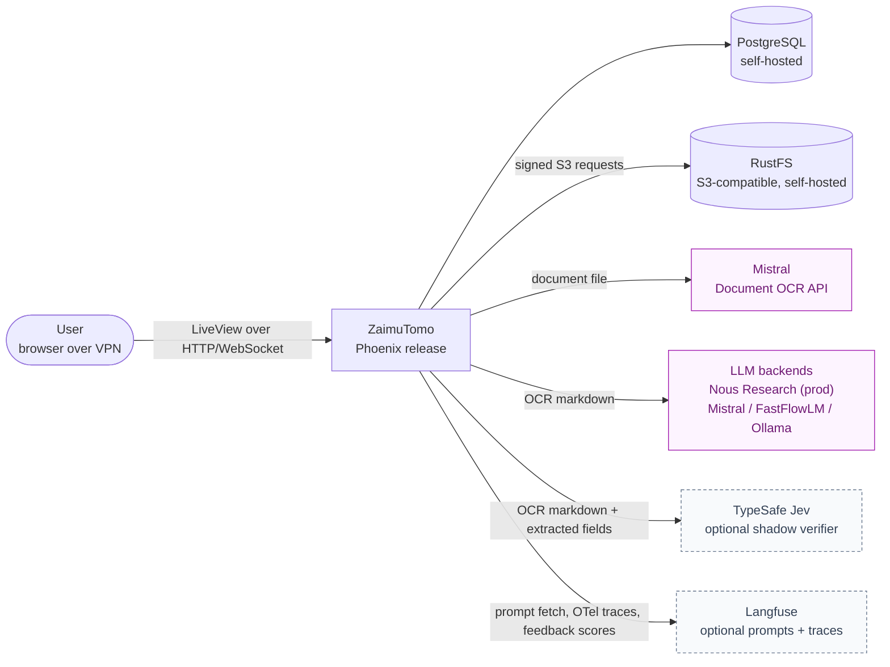
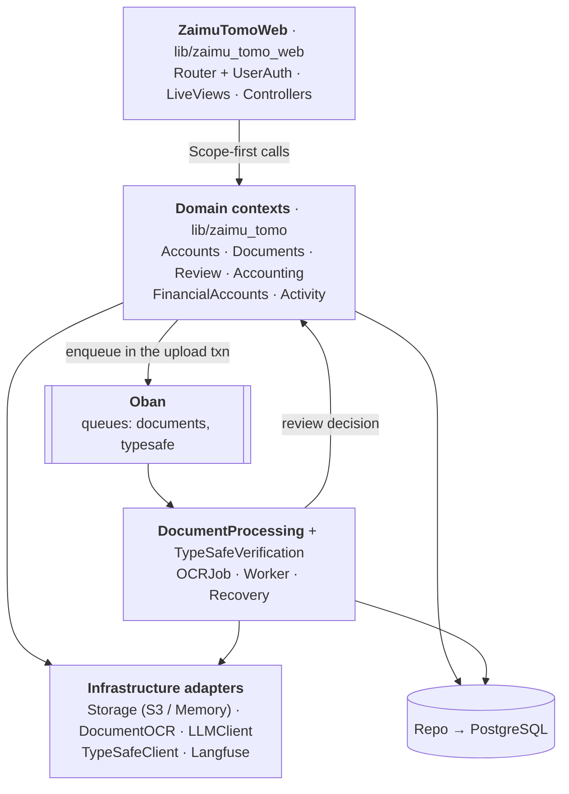
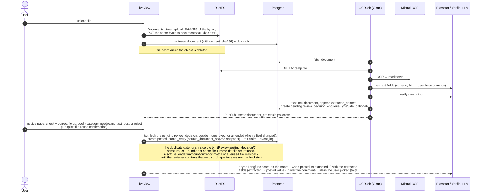
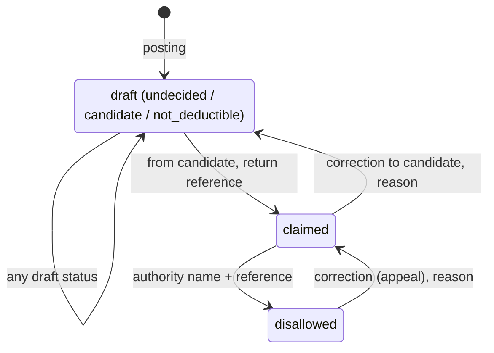
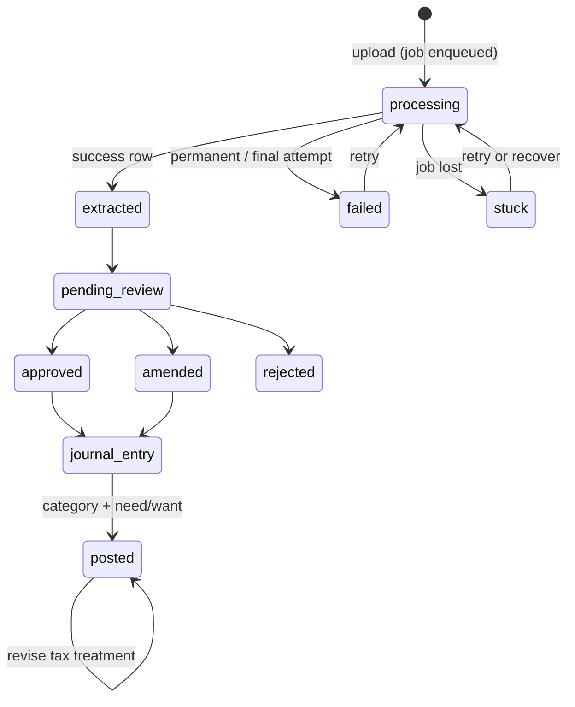
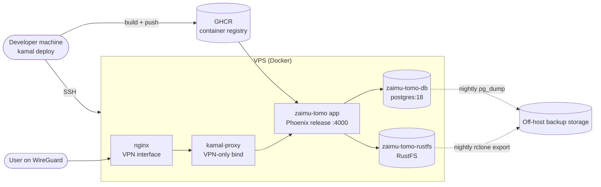
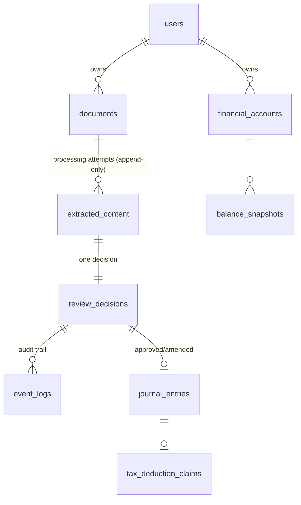

# ZaimuTomo architecture

A lightweight [arc42](https://arc42.org) description of ZaimuTomo, read top-down:
what the system is for, what it talks to, how it is built, how it runs, and why
it looks the way it does. Infrastructure and day-2 operations have their own
pages: [deployment.md](deployment.md), [operations.md](operations.md), and
[configuration.md](configuration.md).

> Keep this file true. When a change alters a context, a flow, a table, a queue,
> an external service, or a deployment unit, update the matching section in the
> same commit. See [docs/README.md](README.md#keeping-the-docs-current).

---

## 1. Introduction and goals

ZaimuTomo (財務の友, "finance friend") is a personal-finance and bookkeeping web
application. The user uploads invoices and receipts. The system reads them with
OCR and LLMs, and the user approves the result before anything enters the books.

Main capabilities:

| Capability | Summary |
|---|---|
| Document intake | Upload invoices and receipts (PDF, images), stored privately in S3-compatible object storage. |
| AI extraction | OCR to markdown (Mistral), LLM extraction of invoice fields, and a second LLM pass that checks the fields are grounded in the document. |
| Human review | Approve, amend, or reject each extraction. Nothing is booked without sign-off. |
| Bookkeeping | An approved or amended invoice becomes a journal entry, booked in the same step with a category, a need/want label, and its tax deductibility. |
| Wealth tracking | Financial accounts (cash, savings, investment) with balance snapshots over time. |
| Insight | Dashboard, activity feed, and monthly and year-to-date spending views. |

### Quality goals

| Priority | Goal | What it means here |
|---|---|---|
| 1 | **Correct books** | AI output is a proposal. Only human-reviewed data becomes a journal entry, and every review decision is logged. |
| 2 | **No lost work** | An accepted upload always gets processed or ends in a visible failure the user can retry. Jobs survive restarts and deploys. |
| 3 | **Privacy** | Financial documents stay on self-hosted infrastructure. The app is reachable only over a VPN. Third parties receive only what they need (OCR and LLM calls). |
| 4 | **Low operating cost and simplicity** | One Phoenix monolith, one Postgres, one object store, on one VPS. No separate job broker or microservices. |
| 5 | **Swappable AI** | OCR, extractor, and verifier backends are selected by configuration, so models can change without code changes. |

### Stakeholders

| Who | Expectation |
|---|---|
| Owner/operator (single developer and primary user) | Understands and can operate the system a year from now from these docs. |
| AI coding agents | Find architecture and conventions quickly, and keep these docs current (see `AGENTS.md`). |

---

## 2. Constraints

- **Stack:** Elixir 1.20 / OTP 28, Phoenix 1.8 with LiveView, Ecto with PostgreSQL 18, Tailwind v4, and esbuild. HTTP calls go through `Req`.
- **Single deployable:** one OTP release in one container, deployed with Kamal 2 to a single VPS.
- **Network:** the app is not exposed on the public internet. Users reach it over WireGuard, and only SSH is public.
- **Background work:** Oban OSS (no Pro features). The queue lives in the same Postgres database.
- **Object storage:** must stay provider-neutral (generic `S3_*` config and SigV4 over `Req`). RustFS is self-hosted today.
- **OCR provider:** Mistral Document OCR is the only OCR implementation.
- **License:** MIT; the source is public. Secrets and host details never go into git.

---

## 3. Context and scope

| Neighbour | Direction | Data that leaves the system | Required? |
|---|---|---|---|
| Browser | in | — | yes |
| PostgreSQL | internal | all relational data and the Oban job table | yes |
| RustFS (S3 API) | internal | original document bytes | yes |
| Mistral OCR | out | the uploaded document file | yes, to process documents |
| Extractor and verifier LLM | out | OCR markdown and extracted fields | yes. In local dev, FLM or Ollama keep it on the machine. Prod sends it to a third-party inference provider (Nous Research by default). |
| TypeSafe | out | OCR markdown and extracted fields | no. Enabled by `TYPESAFE_API_KEY`. |
| Langfuse | out | prompts, traces, and user feedback scores | no. Enabled by `LANGFUSE_*` keys. Local prompt fallbacks exist. |

The browser never talks to object storage or AI providers directly. ZaimuTomo
mediates every access.

---

## 4. Solution strategy

- **Modular monolith.** Phoenix contexts (`lib/zaimu_tomo/*`) own domain logic. LiveViews (`lib/zaimu_tomo_web/live/*`) are thin, and every user-facing query is scoped by `%Accounts.Scope{}`.
- **Durable, transactional jobs.** A document row and its OCR job are inserted in the same Postgres transaction (`Ecto.Multi` plus `Oban.insert`), so an upload cannot exist without its job. Oban retries transient failures and Lifeline rescues jobs orphaned by crashes or deploys.
- **Append-only processing history.** Every terminal processing attempt appends an `extracted_content` row. Retries supersede earlier rows instead of mutating them.
- **Human in the loop.** AI output feeds a review queue. Journal entries are created only from approved or amended decisions, and decisions are audited in `event_logs`.
- **Defence against AI errors.** A second "verifier" LLM checks grounding. An optional independent verifier (TypeSafe) runs in *shadow mode* to gather comparison data without affecting results.
- **Configuration over code for providers.** S3 endpoint, LLM backend, and model per role are all runtime environment variables.
- **Self-hosted by default.** Postgres and RustFS run beside the app as Kamal accessories on the same host.
- **Real-time UI.** Phoenix PubSub broadcasts processing and review events to LiveViews.

---

## 5. Building block view

### Level 1 — the release

| Building block | Path | Responsibility |
|---|---|---|
| `Accounts` | `lib/zaimu_tomo/accounts*` | Users, sessions and tokens (phx.gen.auth), `Scope`, and per-user settings (display name, base currency). |
| `Documents` | `lib/zaimu_tomo/documents*` | Scoped document CRUD. Stores uploads and fingerprints their exact bytes (`store_upload/2`, `Fingerprint`), creates a document and its OCR job atomically, deletes the object after the row is deleted, and owns the fingerprint `FingerprintBackfill`. |
| `DocumentProcessing` | `lib/zaimu_tomo/document_processing*` | OCR → extraction → verification pipeline (`OCRJob`, `Worker`), processing state, retry, stuck-document `Recovery`, and `ErrorClassification`. |
| `TypeSafeVerification` | `lib/zaimu_tomo/type_safe_verification*` | Optional shadow verification job on the `typesafe` queue. |
| `Review` | `lib/zaimu_tomo/review*` | One `ReviewDecision` per extraction (pending → approved / amended / rejected, each final; `failed` when extraction fails), the `EventLog` audit trail, and Langfuse feedback scores. |
| `Accounting` | `lib/zaimu_tomo/accounting*` | Journal entries from decisions, duplicate-invoice detection (`duplicate_check/3`: exact source file, invoice number, and field tuple), posting (category plus need/want; `list_categories/1` suggests the user's own earlier categories), tax deduction claims (set at posting, revised afterwards with `revise_tax_deduction_claim/3`), spending aggregates, and the journal ledger reads: unbooked entries for the booking queue, and posted entries per invoice month and year (`posted_journal_months/2`, `list_posted_journal_entries/3`). |
| `FinancialAccounts` | `lib/zaimu_tomo/financial_accounts*` | Accounts and balance snapshots, net worth by currency. |
| `Activity` | `lib/zaimu_tomo/activity.ex` | A read model assembling each document's current workflow state for the feeds. |
| `Storage` | `lib/zaimu_tomo/storage*` | Provider-neutral facade (`put/get/head/delete/read`) with S3 and in-memory adapters, plus migration and verification tooling. |
| `LLMClient` | `lib/zaimu_tomo/llm_client.ex` | Per-role (extractor and verifier) backend and model resolution through ReqLLM, and response parsing and validation. |
| `Langfuse` | `lib/zaimu_tomo/langfuse.ex` | Prompt fetch (with built-in local fallbacks), OpenTelemetry spans, and feedback scores. |
| `Release` | `lib/zaimu_tomo/release.ex`, `rel/overlays/bin/*` | Release-time commands: migrate, rollback, S3 migration and verification, stuck-document recovery, and the document fingerprint backfill. |

### Level 2 — document processing

| Module | Role |
|---|---|
| `DocumentProcessing.OCRJob` | Oban worker (`documents` queue, 5 attempts, 10-minute timeout, unique per `document_id` while live). Decides retry, failure recording, or cancellation. |
| `DocumentProcessing.Worker` | One attempt: download the object to a temp file → `DocumentOCR` → `LLMClient.extract_invoice` → `LLMClient.verify_extraction` → persist. Persists success only. |
| `DocumentProcessing.ErrorClassification` | Classifies each error as `:transient` or `:permanent`, and produces bounded, body-free summaries. |
| `DocumentProcessing.Recovery` | Finds documents with no extraction and no live job, and re-enqueues them. |
| `ObanFailureLogger` | Telemetry handler that logs failed attempts without payloads. |

---

## 6. Runtime view

### 6.1 Upload → extraction → review → journal entry

`/documents/:id` (`DocumentLive.Show`) is the single page for an invoice through
this whole flow: file preview, lifecycle steps, the check-and-book form, and,
once posted or rejected, a read-only summary with corrections (extracted value
struck through), the comment, the booking, and a history. `/documents` is the
inbox with *Needs action / Posted / Rejected / All* tabs. The old `/reviews`
URLs redirect there. Entries approved before booking was merged into posting are
still `uncategorized` and get a booking form on the same page.

The status shown for a document comes from one rule, `Review.document_status/2`,
on the document list, the dashboard feed and the `/activity` page (both through
`Activity`), and the invoice page: the OCR job queue decides `processing`,
`stalled`, or `failed`, and only a completed extraction is read for `review`,
`posted`, or `rejected`. The OCR worker broadcasts before Oban marks
the job complete, so a reload on that broadcast can still see the job running.
The invoice page and the `/activity` page therefore re-read the state every few
seconds while something is processing.

Whether a posting may go through is decided in one place, inside the posting
transaction: `Review.posting_decision/2` maps the duplicate verdict for the data
being posted and the reviewer's confirmation to post, ask for a confirmation, or
refuse. `approve_invoice/4` and `amend_invoice/5` take the confirmation as
`:confirm` and return `{:error, {:confirmation_required, verdict}}` when it is
missing, so no caller can post a soft match or a reused file unconfirmed. A
confirmation counts only for the verdict it names, and the same transaction
records it in `event_logs` with the matched entry IDs
(`possible_duplicate_confirmed` or `source_file_reuse_confirmed`). A user's postings are
serialized by a transaction-scoped advisory lock, so the check also sees a
posting made at the same moment. The invoice page renders the answer and offers
the confirmation the gate asks for.

A review is decided once. Approving, amending, and rejecting all go through one
transition, `ReviewDecision.decide_changeset/3`, applied to the review row while
it is locked: only a pending review can be decided, and the decision is final.
Of two decisions made at the same moment, the second finds no pending review.
A database trigger refuses any other change of status, whoever writes it, and a
second one refuses a review that is inserted already decided: a review starts
as pending, or as failed when extraction failed.

An entry is posted once. `Accounting.post_entry/6` locks the entry row and books
it only while it is `uncategorized`; a repeat (a stale tab, a replayed event,
the legacy backfill) returns `{:error, :already_posted}` and changes nothing. A
posted entry's category and need/want are final, and its tax treatment changes
only through the revision below.

After posting, the tax treatment stays editable: when the return is filed or
assessed, the user revises the claim on the journal entry page
(`TaxTreatmentComponents.tax_revision_form/1`). `Accounting.revise_tax_deduction_claim/3`
moves the claim along the lifecycle below (`TaxDeductionClaim.next_statuses/1`)
with a reason and the deductible amount, and writes the claim and a
`tax_deduction_claim_revised` event in one transaction,
with the journal entry row locked so concurrent revisions serialize. Saving an
unchanged claim logs nothing. An entry posted before tax claims existed has no claim; revising it creates one.

Corrections are flagged `correction: true` in the event. References that no
longer apply to the new status are cleared; the event records them as `from_`
values. A correction needs a reason different from the stored one, because
the form pre-fills the last reason.

### 6.2 Failure, retry and recovery

- **Transient error** (timeouts, 408, 429, 5xx, transport errors) on a non-final attempt: the job returns `{:error, summary}` and **persists nothing**. Oban backs off and retries.
- **Permanent error**, or a transient error on the final attempt (5): the job appends one `failed` `extracted_content` row and a `failed` review decision, broadcasts `user:<id>:document_processing:failed`, and completes.
- **Concurrency safety:** every terminal write locks the document row and checks that the latest extraction is still the one expected when the job was enqueued. Otherwise it cancels with `:already_processed`.
- **Crash or deploy mid-run:** `Oban.Lifeline` moves `executing` jobs back after 30 minutes.
- **User retry:** `DocumentProcessing.retry_document/2` re-enqueues documents in the `:failed` or `:stuck` state. The new run supersedes the old row, which stays as history. A successful enqueue broadcasts `user:<id>:document_processing:retried` so open views refresh.
- **UI state:** the documents Index and the processing hero derive each row's state from `DocumentProcessing.processing_states/1` (live job + latest extraction, two batched queries), the same semantics as `processing_state/1` on Show. A failed row with a live re-run shows "Processing" and keeps the failure note.
- **Operator recovery:** `bin/recover_stuck_documents` (see [operations.md](operations.md#stuck-documents)).

### 6.3 TypeSafe shadow verification (optional)

When `TYPESAFE_API_KEY` is set, the success transaction also enqueues a
`TypeSafeVerification.Worker` job on the `typesafe` queue, isolated by a
savepoint so an enqueue failure never rolls back the extraction. The job re-reads
the OCR markdown from the stored row; job args never contain financial text. It
writes per-field error probabilities to
`extracted_content.analysis.verification.typesafe_shadow` and never changes the
authoritative verification result. It is fail-open: provider errors are recorded
on the row and the job completes.

---

## 7. Deployment view

| Environment | How it runs |
|---|---|
| Local dev | `docker compose` for Postgres and RustFS, then `mix phx.server`. Local LLMs (FastFlowLM or Ollama) or cloud backends. |
| Test / CI | GitHub Actions (`.github/workflows/ci.yml`): Postgres service, `mix compile --warnings-as-errors`, `mix test`. The in-memory storage adapter and Oban `testing: :manual` are used. RustFS integration tests are opt-in (`RUN_INTEGRATION=true`, Testcontainers). |
| Amp orb | `.agents/setup` and `.agents/resume` prepare a disposable dev sandbox (orb only, never production). |
| Production | Kamal 2 on a single VPS, as above. Details: [deployment.md](deployment.md). |

---

## 8. Crosscutting concepts

### Data model

- `documents` stores `filename` (original name), `object_key` (`documents/<uuid>.<ext>`), and `content_sha256` (SHA-256 of the exact uploaded bytes, lowercase hex; null for legacy rows until the backfill reads them). The bytes live only in object storage. Replacing the object replaces the digest.
- `extracted_content` holds `extracted_data` (an embedded schema), `raw_llm_response`, an `analysis` map (verification and TypeSafe shadow results), `status` (`success` or `failed`), `error_details`, and the Langfuse `trace_id`.
- Money is stored in integer cents with an ISO currency code. Each user has a `base_currency` (default CHF), which is snapshotted into each OCR job as the currency hint.
- `oban_jobs` lives in the same database. Finished jobs are pruned after 7 days.
- Deleting a document that has a posted journal entry is blocked by a foreign key.
- `review_decisions.review_status` changes only through `ReviewDecision.decide_changeset/3`: pending → approved, amended, or rejected, and nothing leaves those or `failed`. `Review` decides a row it holds locked (`FOR UPDATE`) inside the transaction that also writes the event log, so concurrent decisions on one review have one winner. Check constraints restrict the status to the five known values and require a non-blank `rejection_reason` on a rejected row. Two triggers, the only ones in the schema, enforce the machine for every writer, including raw SQL. `review_decisions_guard_transition` enforces the transition rule: an update that changes the status in any other way fails as a check violation named `review_decisions_transition_check`, which `decide_changeset/3` reports as an error on `review_status`. `review_decisions_guard_initial_status` enforces the starting states: an insert in any status but pending or failed fails as a check violation named `review_decisions_initial_status_check`, and `changeset_for_create/1` validates the same. Updates that leave the status alone and deletes are not affected. An insert trigger runs before check constraints, so an unknown status is refused by it first and the status check is a backstop.
- `tax_deduction_claims` has at most one row per journal entry; entries posted before the table existed have none until a revision creates it. Posting accepts only the draft statuses `undecided`, `candidate`, and `not_deductible`; a revision of a posted entry follows the lifecycle in §6.1 to `claimed` (included in the tax return; `tax_return_reference` required) and `disallowed` (refused by the tax authority; `authority_name` and `authority_reference` required, return reference kept). Check constraints enforce the required references in the database. `not_deductible` and `disallowed` always store a deductible amount of 0; otherwise a revised amount lies between 0 and the entry amount (negative for a credit note). `notes` holds the latest revision reason (up to 255 characters). The history lives in `event_logs`: each `tax_deduction_claim_revised` event (`invoice_id` = journal entry ID) records `from_status`/`to_status`, `from_deductible_amount_cents`/`to_deductible_amount_cents`, `tax_year`, `reason`, `correction`, and the old and new value of each reference (`from_`/`to_tax_return_reference`, `from_`/`to_authority_name`, `from_`/`to_authority_reference`).
- A partial unique index on `journal_entries (user_id, lower(btrim(issuer)), lower(btrim(invoice_number)))` blocks posting the same numbered invoice twice per user. An unnumbered invoice matching an existing entry's exact `(issuer, date, amount, currency)` tuple is a soft match that requires explicit reviewer confirmation to post. No index covers a soft match: the duplicate gate in the posting transaction enforces it (§6, D21) and logs the confirmation as a `possible_duplicate_confirmed` event with the matched entry IDs (D24). See `Accounting.duplicate_candidates/2`.
- `journal_entries.source_document_sha256` is an immutable posting-time copy of the source document's `content_sha256`; `source_file_reuse_confirmed` (default false) marks a posting the reviewer explicitly confirmed as a reuse of the same file. The partial unique index `journal_entries (user_id, source_document_sha256) WHERE source_document_sha256 IS NOT NULL AND NOT source_file_reuse_confirmed` allows one unconfirmed posting per file per user. `Accounting.duplicate_check/3` ranks matches as same file > invoice number > same details; a file match is confirmable only when no field rule also matches (the tuple is compared against the file-matched entries even for numbered invoices). Confirmations are logged as `source_file_reuse_confirmed` events with the matched entry IDs. Fingerprints are user-scoped, redacted from inspect output, and never rendered or sent to an AI provider. Only `FingerprintBackfill` may set them on existing entries; there is no immutability trigger on `journal_entries` yet, and any future one must run after the backfill or allow it.

### Multi-tenancy and authorization

Every context function takes `%Accounts.Scope{}` first and filters by
`scope.user.id`. Routes requiring login live in `live_session :require_authenticated_user`.
Unscoped functions exist only for maintenance tasks (storage verification,
stuck recovery, fingerprint backfill) and say so in their docs.

### Background jobs (Oban)

| Queue | Worker | Concurrency (env) | Attempts | Notes |
|---|---|---|---|---|
| `documents` | `DocumentProcessing.OCRJob` | `OBAN_DOCUMENTS_CONCURRENCY` (2) | 5 | Unique per document while live. 10-minute timeout. |
| `typesafe` | `TypeSafeVerification.Worker` | `TYPESAFE_MAX_CONCURRENCY` (2) | 3 | Fail-open shadow run. |

Plugins: `Oban.Pruner` (7 days) and `Oban.Lifeline` (30 minutes, which must exceed
the OCR timeout). Rules: job args are self-contained commands resolved at
enqueue time, and they never carry document text or provider payloads.

### AI pipeline configuration

OCR always uses Mistral. The extractor and verifier each take an explicit
`backend` (`nousresearch | mistral | flm | ollama`) and `model`. There is no
fallback. Prompts (`extract-invoice`, `verify-extraction`) come from Langfuse
(label `production`) when Langfuse is enabled, and from built-in local templates
otherwise. See [local-ai.md](local-ai.md) and [configuration.md](configuration.md).

### Observability

- **Tracing:** OpenTelemetry spans per document (`process-invoice` → extraction, verification, TypeSafe shadow), exported to Langfuse when it is enabled. The trace ID is stored on the extraction, so user 👍/👎 feedback becomes a Langfuse score.
- **Logs:** tagged prefixes (`[OCR]`, `[TypeSafe]`). Failures are logged as bounded summaries, never as OCR text or provider bodies. The default formatter includes the request ID and TypeSafe status, model, error class, and sanitized stacktrace metadata; development keeps its message-only format.
- **Health:** `GET /health` and `/up` (no session or auth), used by kamal-proxy and the Docker `HEALTHCHECK`.
- **LiveDashboard:** dev only (`/dev/dashboard`).

### Security and privacy

- VPN-only exposure, private bucket, and app-mediated preview and download (`DocumentController`, inline only for PDFs and images).
- Secrets come from environment variables at runtime (`config/runtime.exs`), supplied by Kamal from `.kamal/secrets`, which is not committed.
- Financial text is kept out of `oban_jobs`, logs, and error summaries.

### Real-time UI

PubSub topics: `user:<id>:documents`, `user:<id>:document_processing:success|failed|retried`,
`invoice_review:completed`, and `user:<id>:financial_accounts`. LiveViews
subscribe in `mount/3` when connected.

Account settings renders inside the authenticated `zaimutomo` root layout.
Its `Layouts.app` call uses `shell: :product` to render content and LiveView
flash messages without duplicating the standalone authentication navigation.
Profile, email, and password remain independent forms; sensitive changes still
require a recent login. Settings styles are scoped to avoid altering other pages.

The login page (`UserLive.Login`, `/users/log-in`) and the magic-link page
(`UserLive.Confirmation`, `/users/log-in/:token`) render under the standalone
`root` layout with `Layouts.app shell: :bare`, so they bring their own
full-page chrome: the shared dark brand panel `ZaimuComponents.auth_stage/1`
beside a "sign-in slip" form. Their styles live in `assets/css/login.css`, and
the `root` layout loads the same Geist and Instrument Serif fonts as the
`zaimutomo` layout. Both pages use a single "Keep me signed in" checkbox:
checking it posts `remember_me=true`, which makes `UserAuth` write the
remember-me cookie; leaving it unchecked logs in for the browser session only.

### Testing

ExUnit with the SQL sandbox. Storage uses the Memory adapter, HTTP uses
`Req.Test` stubs, and Oban runs in manual testing mode. Run `mix precommit`
before committing (compile with warnings as errors, unlock unused deps, format,
test), plus `mix credo --strict`, which is blocking in CI (§9 D15).

---

## 9. Architecture decisions

Short decision records, newest last. Add one when a change alters structure,
infrastructure, or a cross-cutting rule. Older, longer feature-level reasoning
is in [`specs/`](../specs/README.md).

| # | Date | Decision | Why / consequences |
|---|---|---|---|
| D1 | 2026-01 | Phoenix LiveView monolith with phx.gen.auth scopes | One deployable, server-rendered real-time UI. All data is scoped per user. |
| D2 | 2026-03 | Persist every extraction attempt as a row; one review decision per extraction | Keeps history, and humans approve before booking. See `specs/001`, `specs/002`. |
| D3 | 2026-05 | Journal entries only from approved or amended decisions | AI never writes to the books directly. |
| D4 | 2026-06 | Kamal 2 on a single VPS, app reachable only over WireGuard | Low cost, private by default. Postgres runs as a Kamal accessory. |
| D5 | 2026-08 | Per-role LLM backends (extractor and verifier) selected by env, with no fallback | Models can be swapped or mixed (local and cloud) without code changes. Misconfiguration fails loudly. |
| D6 | 2026-08 | Document bytes in S3-compatible storage (self-hosted RustFS), with a provider-neutral `Storage` facade | Decouples bytes from the release. A later provider switch is config only. See `specs/003`. |
| D7 | 2026-09 | TypeSafe Jev as a *shadow* verifier | Collects independent per-field error probabilities without affecting outcomes until it is trusted. |
| D8 | 2026-09 | Replace fire-and-forget `Task` OCR with durable Oban jobs, enqueued in the upload transaction | Uploads can't lose their job. Retries, Lifeline rescue, user retry, and operator recovery. The TypeSafe shadow also moved to Oban. |
| D9 | 2026-10 | Add `stream_data` (test-only) for property-based tests on pure, boundary-heavy logic (currency normalization, error-retry classification, changeset validity, aggregation sums) | Generates and shrinks adversarial inputs instead of relying only on hand-picked examples; already caught an Ecto blank-string edge case in `Currency.normalize_and_validate/2`. DB-backed properties cap `max_runs` explicitly to bound CI time; `config :stream_data, max_runs` is lower locally, higher in CI (`CI=true`, set by GitHub Actions by default). |
| D10 | 2026-08 | Duplicate invoice detection: DB-enforced unique index, plus the journal entry in the same transaction as the review decision | A numbered invoice (same user, issuer, invoice number) cannot post twice; the database enforces it regardless of code path. An unnumbered exact `(issuer, date, amount, currency)` match warns and needs explicit confirmation. Posting the journal entry, tax claim, and event log now happens in the same `Ecto.Multi` as the decision update, so a duplicate or a failed audit write rolls the whole transition back — closing the gap in §11. |
| D11 | 2026-10 | Exact-byte SHA-256 fingerprints as an OCR-independent duplicate signal, copied to the journal entry at posting and enforced by a per-user partial unique index over unconfirmed postings | Re-uploading identical bytes is caught even when OCR/LLM reads different fields. A unique constraint cannot span document → extraction → review → entry, so the digest is snapshotted on the entry. Legitimately reused files (QR-bills, standing slips) post only with an explicit per-posting confirmation, recorded on the entry and in the event log. Legacy rows are filled by an online, idempotent backfill through the `Storage` facade, never by a migration. See `specs/004`. |
| D12 | 2026-10 | Upgrade to Elixir 1.20 (OTP unchanged at 28) | Elixir 1.20 completes zero-annotation type inference across all constructs, so the existing `mix compile --warnings-as-errors` CI gate now also catches unreachable clauses and dead code for free, no specs or Dialyzer required. Surfaced and removed 3 pre-existing dead branches (`review.ex`, `llm_client.ex`, `langfuse.ex`) that the 1.19 compiler couldn't see. First step toward the CI reliability work tracked for direct-to-main pushes; a complementary nightly Dialyzer job (whole-program success typing) is still planned separately. |
| D13 | 2026-10 | Split CI into `lint` / `test` / `security-audit` jobs; `mix credo --strict` and `mix hex.audit` run on every push but are advisory (non-blocking), with a separate nightly workflow re-running the audit so a CVE disclosed on a quiet day still gets caught | First step of hardening CI as the real safety net for pushing straight to `main` with less manual review. Credo and the audit aren't required checks yet because both already have a pre-existing backlog (51 Credo issues; `hackney` pinned to a vulnerable 1.x line by a test-only dependency) unrelated to any one change — see §11. `mix hex.audit` found 6 live advisories in locked dependencies; the `bandit` ones were fixed by a routine version bump in the same change, `hackney`'s needs a dependency change tracked separately. |
| D14 | 2026-10 | Add Dialyzer (dialyxir) as a nightly, advisory-only CI job rather than a required per-push check | Whole-program success typing complements the Elixir 1.20 compiler's own type inference (D12) by also checking across the OTP/dependency boundary, but PLT builds are too slow for a per-push gate. First run found 10 findings: 3 duplicated dead code already fixed by the Elixir 1.20 upgrade; 5 are a well-known Dialyzer/`Ecto.Multi` opaque-`MapSet` false positive; 2 (`storage/s3.ex`) are a `File.stream!/2` success-typing gap verified benign directly in `iex` before suppressing. All 7 non-duplicate false positives are listed individually in `.dialyzer_ignore.exs` with the reasoning, not blanket-ignored, so a genuinely new finding in the same file still surfaces. Also added missing `@type t :: %__MODULE__{}` to `ExtractedData` and `ExtractedContent.ExtractedContent` (matching the convention already used in `Document`/`ReviewDecision`), which cleared 9 separate `unknown_type` findings and makes every existing `@spec` referencing them actually checked going forward. |
| D15 | 2026-10 | Clear the 51-finding Credo backlog and make `mix credo --strict` blocking in the existing `lint` CI job | Supersedes D13's advisory Credo policy so new findings fail CI instead of rebuilding the backlog. Reorder aliases, alias nested module calls, use implicit function-level rescue/catch and readable string sigils, use `ReviewDecision.t()` in specs, and configure the existing TypeSafe Logger metadata explicitly. The two upload-test TODOs were stale: the same file already exercises uploads and edit submission, so replace them with references to that coverage. No checks are disabled and no findings are suppressed. Security audit and nightly Dialyzer remain advisory; GitHub branch protection settings are unchanged. |
| D16 | 2026-10 | Pin every workflow job to `runs-on: ubuntu-26.04` instead of `ubuntu-latest` | GitHub migrated the `ubuntu-latest` label from Ubuntu 24.04 to 26.04 gradually between October 19 and November 19, 2026, so two runs of the same commit could land on different images with no repo change. Pinning makes the toolchain that a green build was verified against explicit and reproducible, and turns the next image adoption into a deliberate commit rather than a silent rollover. `ubuntu-26.04` is GA on x64, and all five jobs only need Docker, the Postgres service container, and `erlef/setup-beam`'s Elixir/OTP builds, which the new image supports. |
| D17 | 2026-11 | One invoice page (`/documents/:id`) replaces the review, amend, and journal-entry posting screens, so it is the only place an entry is booked; checking and booking are one transaction. `/documents/:id/edit` remains and only replaces the stored file | The flow split one invoice over three pages that did not link to each other, so a treated or amended invoice was hard to find again. `Review.approve_invoice/4` and `amend_invoice/5` take `:booking` and `:tax_claim_attrs`, and `Accounting.create_multi_from_decision/3` posts the entry inside the existing review transaction, so a booking error rolls back the whole posting like a duplicate does. One comment per invoice (stored as review notes and copied to the entry's notes). Extraction feedback is sent automatically on posting so Langfuse gets a signal for every posted invoice. A rejection sends a score only when the user picked 👍/👎, because a correctly read duplicate is rejected too. |
| D18 | 2026-11 | Tax claims follow an explicit lifecycle: drafts move freely, `candidate` → `claimed` needs a tax return reference, `claimed` → `disallowed` needs the authority name and reference, and the corrections `claimed` → `candidate` and `disallowed` → `claimed` need a reason | Replaces the free status edit of the first revision form. A refusal only makes sense after filing, and the references are what a follow-up with the tax office needs, so they are required in the changeset and by check constraints. Appeals and mistaken filings happen, so the two corrections exist but are flagged in the event log. Adapted from the unmerged PR #38 (`feat/tax-claim-lifecycle`), without its separate `/tax_claims` pages. Rows set to `claimed` or `disallowed` before the references existed are marked `not recorded` by the migration. |
| D19 | 2026-11 | Posting a journal entry is a one-way latch: `Accounting.post_entry/6` locks the row and books only an `uncategorized` entry, booking takes draft tax statuses only, and `JournalEntry.changeset_for_categorize/2` sets `posted` itself instead of casting a status | A second `post_entry` used to overwrite the category and write the tax claim without the D18 lifecycle, so a filed or refused claim could be reset with no revision event (reachable from a stale tab, a replayed `book` event, and the legacy backfill's manual decisions). The row lock is the one `revise_tax_deduction_claim/3` takes, so posting and revising serialize. Consequence: a posted entry cannot be recategorised; that would need its own named move with an audit event. |
| D20 | 2026-11 | One status rule for every surface: the dashboard feed and the invoice page take a document's status from `Review.document_status/2`, as the document list does, and `status_pill` renders `stalled` itself | The feed read only the latest extraction, so a document with no OCR run pulsed "Processing" forever and a failed document being retried stayed "Failed"; the invoice page kept its own copy of the rule. Consequence: `Documents.get_document_with_content!/2` preloads the decision's journal entry, which the rule needs. |
| D21 | 2026-11 | One duplicate gate, inside the posting transaction: `Review.posting_decision/2` maps (verdict, confirmation) to post, confirm, or refuse; `approve_invoice/4` and `amend_invoice/5` take `:confirm` (`:possible` or `:file_reuse`, replacing `:confirm_file_reuse`) and always re-check; a per-user `pg_advisory_xact_lock` serializes postings | The rule had three owners. The invoice page alone decided soft matches ("Post anyway"), so any other caller of the context posted them silently; the transaction re-checked a reused file only when told it was confirmed; unique indexes caught the two hard blocks. Without the lock two identical unnumbered invoices approved at the same moment both posted, because no index covers a soft match. Consequences: an unconfirmed reused file now returns `{:confirmation_required, :file_reuse}` instead of `:duplicate_invoice`, `:file_reuse_not_applicable` is `:confirmation_not_applicable`, and the unique indexes stay as a backstop. |
| D22 | 2026-11 | One review transition: `ReviewDecision.decide_changeset/3` moves a pending review to approved, amended, or rejected and refuses every other state; `Review` locks the review row inside the transaction before deciding; rejecting is a transaction that includes its event log; `Review.update_review_decision/2` and `changeset_for_update/2` are removed; check constraints on `review_status` and on the reason of a rejected row | The update changeset accepted any status from any status, and approve, amend, and reject each read "pending" before their write without a lock. Approving and rejecting one review at the same moment both succeeded, leaving a rejected review that owns a posted journal entry. Consequences: the loser of such a race gets "No pending review found for this invoice"; a rejection whose audit event cannot be written is rolled back instead of logged as a warning; rejected rows without a reason are backfilled as `not recorded`. |
| D23 | 2026-11 | Enforce the review transition in the database: the `BEFORE UPDATE` row trigger `review_decisions_guard_transition` allows a status change only from pending to approved, amended, or rejected and raises a check violation named `review_decisions_transition_check` otherwise | D22 put the rule in the application only, and its check constraints cannot see the previous status, so a raw update, a backfill, or a changeset built on a stale pending read could still move an approved review to rejected and leave its journal entry. Consequences: this is the first trigger in the schema, so the rule now lives in two places (`ReviewDecision.decide_changeset/3` and the trigger function) and a new status or move needs a migration that replaces the function; a deliberate manual correction of a decided review needs the trigger disabled for that transaction. |
| D24 | 2026-11 | Every duplicate confirmation is audited: confirming a soft match ("Post anyway") writes a `possible_duplicate_confirmed` event in the posting transaction, with the new entry ID and the matched entry IDs, beside the existing `source_file_reuse_confirmed` event | A confirmed file reuse left a flag on the entry and an event; a confirmed soft match left neither, so a pair of look-alike entries could not be told apart from an override the reviewer chose, and nothing recorded which entry was overridden. Consequences: the event type follows the confirmation through one table in `Review`, so a new confirmable verdict needs its event type there; a confirmation whose event cannot be written rolls the posting back; soft matches confirmed before this change have no event and are not backfilled. |
| D25 | 2026-11 | A review starts as pending or failed, in the database: the `BEFORE INSERT` row trigger `review_decisions_guard_initial_status` refuses any other status with a check violation named `review_decisions_initial_status_check`, and `ReviewDecision.changeset_for_create/1` validates the same | D23 guarded updates only, so a raw insert, an import, or `changeset_for_create/1` (which accepted all five statuses) could create a review already approved or rejected, with no pending state, no lock, no event log, and no journal entry. A check constraint cannot tell an insert from an update. The trigger is fail-closed: it lists the two allowed statuses, so a future status is not insertable until a migration allows it. Consequences: a full `pg_dump` restore is unaffected because rows load before triggers are created, but a data-only load of decided reviews needs `--disable-triggers` ([operations.md](operations.md)); the rule lives in the changeset and in the trigger function; existing rows are not checked. |

---

## 10. Quality requirements

| Scenario | Expected behaviour |
|---|---|
| The app is redeployed while a document is being processed | Lifeline rescues the job and the document is processed exactly once (no duplicate terminal rows). |
| The LLM provider returns 429 or 5xx | Retried with backoff up to 5 attempts, then one visible failure the user can retry. |
| TypeSafe is down or slow | Extraction is unaffected. The shadow result records a failure. |
| A user opens another user's document ID | Not found (scoped query). |
| The VPS is lost | Restore from the off-host object export plus the Postgres dump, then `bin/verify_storage` reports zero missing objects. |
| Switching the LLM model | Env change and redeploy only. |
| The same file is uploaded and approved twice concurrently | At most one journal entry commits (unique index); the other review rolls back and stays pending. |

---

## 11. Risks and technical debt

| Item | Notes |
|---|---|
| Legacy upload volume | `zaimu_tomo_uploads` is still mounted (`config/deploy.yml`, `Dockerfile`) from the pre-S3 migration. Remove it after the restore check is recorded (see [operations.md](operations.md#legacy-upload-volume)). |
| Single host | App, DB, and object store share one VPS. Backups are the only DR mechanism. |
| No production mailer | `runtime.exs` configures no Swoosh adapter for prod, so email-based auth flows (confirmation, magic links) don't deliver in production. |
| Shared S3 credential | The app's S3 key is the RustFS root credential. Per-application credentials are not yet introduced. |
| `force_ssl` off | HTTP behind the VPN is by design. Enable `FORCE_SSL` at build time if the app is ever exposed publicly. |
| Fingerprint coverage of legacy postings | Exact-file protection covers historical entries only after `bin/backfill_document_fingerprints` reports complete coverage. Missing objects and unresolved same-user collisions stay null and are not protected (see [operations.md](operations.md#document-fingerprint-backfill)). |
| Confirmed reuses are not DB-constrained | A confirmed file reuse is excluded from the unique index; the "no field match" condition is checked in the posting transaction, not by a constraint, so two simultaneous postings by the same user could both pass it. |
| Temporary test-only `hackney` override | Testcontainers 2.4.0 requires vulnerable Hackney 1.x. A test-only `~> 4.9` override keeps it on the patched line; the locked Tesla 1.21.2 supports Hackney 4.x. Hackney remains excluded from production, but its required IDNA 7.1 upgrade is shared with production's JSV and Swoosh dependencies, whose constraints allow it. Remove the override once a published Testcontainers release includes [upstream's Hackney 4 support](https://github.com/testcontainers/testcontainers-elixir/commit/f73bac030ffa40beb34793470d8d29d56ad4b03c), preserving a patched lockfile. Validate Docker compatibility with `RUN_INTEGRATION=true mix test test/zaimu_tomo/storage/rustfs_integration_test.exs` when updating this dependency. |
| Hackney 4 Unix-socket pooling | Hackney 4.8.5's default pool replaces the Unix-socket transport with TCP, producing `:nxdomain` for Testcontainers' Docker socket path. `config/test.exs` disables Hackney's default pool so Docker requests retain their Unix-socket transport. Remove this test-only workaround once a fixed Hackney release passes the RustFS integration tests with pooling enabled. |
| Resolved dependency advisories (2026-10-26) | ReqLLM 1.29.0 fixes WebSocket TLS verification (CVE-2026-107685); Plug.Crypto 2.2.1 fixes secret-bearing stack traces (CVE-2026-105963). Both advisories were published after the successful October 23 nightly audit. Bandit 1.14.0 and test-only Hackney 4.9.1 also resolve the advisories published later on October 26. Direct dependency requirements exclude the vulnerable lines; `mix.lock` pins the patched transitive Plug.Crypto release. Keep running `MIX_ENV=test mix hex.audit`: a green overall CI result does not guarantee a clean audit because the per-push security job is advisory. |
| Resolved TLS hostname advisory (2026-10-30) | `mix.lock` pins `ssl_verify_fun` 1.1.8 to fix [CVE-2026-117666](https://cna.erlef.org/cves/CVE-2026-117666.html), which let partial-label wildcards span DNS labels and wildcard DNS names match IP literals. It is a production dependency through OpenTelemetry Exporter → `tls_certificate_check`, and a test dependency through Hackney. Both parents' existing constraints accept the patch, so no override is needed. Their default SNI and OTP hostname checks mitigate this flaw on OTP 28; retain those checks rather than relying solely on the library callback. |
| Resolved HTML attribute and JSON Schema advisories (2026-11-03) | Phoenix.HTML 4.4.0 fixes attribute injection through unvalidated attribute names ([CVE-2026-117645](https://cna.erlef.org/cves/CVE-2026-117645.html)); the direct `~> 4.4` requirement excludes vulnerable releases. `mix.lock` pins JSV 0.26.2 to fix regex-budget exhaustion being treated as a non-match, bypassing JSON Schema validation ([CVE-2026-117680](https://cna.erlef.org/cves/CVE-2026-117680.html)). ReqLLM's existing JSV constraint accepts the patch, so no override or new direct dependency is needed. |

---

## 12. Glossary

| Term | Meaning |
|---|---|
| Extraction / extracted content | One processing attempt's result for a document (success or failed). |
| Extractor / verifier | The two LLM roles: extract the invoice fields, then check they are grounded in the OCR text. |
| Shadow verification | TypeSafe Jev run whose results are stored for comparison but never used for decisions. |
| Review decision | A human verdict on an extraction: pending, approved, amended, rejected, or failed. |
| Journal entry | A booked expense, posted with a category and need/want label. Entries approved before D17 may still be `uncategorized` until booked. |
| Stuck document | Has no extraction row and no live OCR job. |
| Currency hint | The user's base currency, snapshotted when the job is enqueued, to guide extraction. |
| Accessory | A Kamal-managed sidecar container (Postgres, RustFS). |
| Orb | An Amp cloud sandbox used for agent development. |
