# ZaimuTomo architecture

A lightweight [arc42](https://arc42.org) description of ZaimuTomo, read top-down:
what the system is for, what it talks to, how it is built, how it runs, and why
it looks the way it does. Infrastructure and day-2 operations have their own
pages: [deployment.md](deployment.md), [operations.md](operations.md), and
[configuration.md](configuration.md).

> Keep this file true. When a change alters a context, a flow, a table, a queue,
> an external service, or a deployment unit, update the matching section in the
> same commit. See [docs/README.md](README.md#keeping-the-docs-current).

---

## 1. Introduction and goals

ZaimuTomo (財務の友, "finance friend") is a personal-finance and bookkeeping web
application. The user uploads invoices and receipts. The system reads them with
OCR and LLMs, and the user approves the result before anything enters the books.

Main capabilities:

| Capability | Summary |
|---|---|
| Document intake | Upload invoices and receipts (PDF, images), stored privately in S3-compatible object storage. |
| AI extraction | OCR to markdown (Mistral), LLM extraction of invoice fields, and a second LLM pass that checks the fields are grounded in the document. |
| Human review | Approve, amend, or reject each extraction. Nothing is booked without sign-off. |
| Bookkeeping | An approved or amended invoice becomes a journal entry, booked in the same step with a category, a need/want label, and its tax deductibility. |
| Wealth tracking | Financial accounts (current, savings, cash, investment, credit card) with balance snapshots over time. Balances are from the account holder's side, so card debt is negative. |
| Statements | Upload a monthly bank or card statement against a financial account. It is read page by page into its lines, and `opening + lines = closing` checks the read. Each payment line shows the booked invoice that backs it, or that none does yet. |
| Insight | Dashboard, activity feed, and monthly and year-to-date spending views. |

### Quality goals

| Priority | Goal | What it means here |
|---|---|---|
| 1 | **Correct books** | AI output is a proposal. Only human-reviewed data becomes a journal entry, and every review decision is logged. |
| 2 | **No lost work** | An accepted upload always gets processed or ends in a visible failure the user can retry. Jobs survive restarts and deploys. |
| 3 | **Privacy** | Financial documents stay on self-hosted infrastructure. The app is reachable only over a VPN. Third parties receive only what they need (OCR and LLM calls). |
| 4 | **Low operating cost and simplicity** | One Phoenix monolith, one Postgres, one object store, on one VPS. No separate job broker or microservices. |
| 5 | **Swappable AI** | OCR, extractor, and verifier backends are selected by configuration, so models can change without code changes. |

### Stakeholders

| Who | Expectation |
|---|---|
| Owner/operator (single developer and primary user) | Understands and can operate the system a year from now from these docs. |
| AI coding agents | Find architecture and conventions quickly, and keep these docs current (see `AGENTS.md`). |

---

## 2. Constraints

- **Stack:** Elixir 1.20 / OTP 28, Phoenix 1.8 with LiveView, Ecto with PostgreSQL 18, Tailwind v4, and esbuild. HTTP calls go through `Req`.
- **Single deployable:** one OTP release in one container, deployed with Kamal 2 to a single VPS.
- **Network:** the app is not exposed on the public internet. Users reach it over WireGuard, and only SSH is public.
- **Background work:** Oban OSS (no Pro features). The queue lives in the same Postgres database.
- **Object storage:** must stay provider-neutral (generic `S3_*` config and SigV4 over `Req`). RustFS is self-hosted today.
- **OCR provider:** Mistral Document OCR is the only OCR implementation.
- **License:** MIT; the source is public. Secrets and host details never go into git.

---

## 3. Context and scope

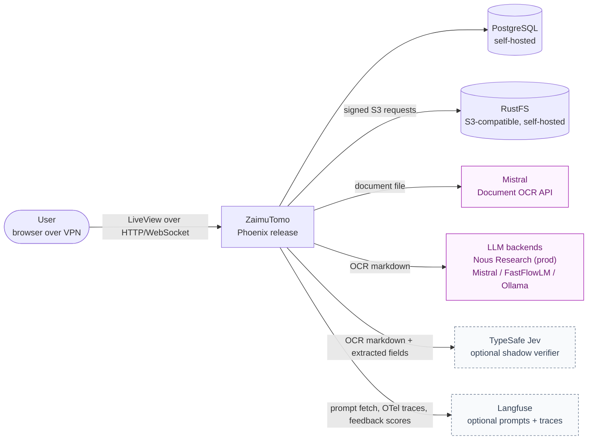

| Neighbour | Direction | Data that leaves the system | Required? |
|---|---|---|---|
| Browser | in | — | yes |
| PostgreSQL | internal | all relational data and the Oban job table | yes |
| RustFS (S3 API) | internal | original document bytes | yes |
| Mistral OCR | out | the uploaded document or statement file | yes, to process documents and statements |
| Extractor and verifier LLM | out | OCR markdown (invoice, or one statement page per call) and extracted fields | yes. In local dev, FLM or Ollama keep it on the machine. Prod sends it to a third-party inference provider (Nous Research by default). |
| TypeSafe | out | OCR markdown and extracted fields | no. Enabled by `TYPESAFE_API_KEY`. |
| Langfuse | out | prompts, traces, and user feedback scores | no. Enabled by `LANGFUSE_*` keys. Local prompt fallbacks exist. |

The browser never talks to object storage or AI providers directly. ZaimuTomo
mediates every access.

---

## 4. Solution strategy

- **Modular monolith.** Phoenix contexts (`lib/zaimu_tomo/*`) own domain logic. LiveViews (`lib/zaimu_tomo_web/live/*`) are thin, and every user-facing query is scoped by `%Accounts.Scope{}`.
- **Durable, transactional jobs.** A document row and its OCR job are inserted in the same Postgres transaction (`Ecto.Multi` plus `Oban.insert`), so an upload cannot exist without its job. Oban retries transient failures and Lifeline rescues jobs orphaned by crashes or deploys.
- **Append-only processing history.** Every terminal processing attempt appends an `extracted_content` row. Retries supersede earlier rows instead of mutating them.
- **Human in the loop.** AI output feeds a review queue. Journal entries are created only from approved or amended decisions, and decisions are audited in `event_logs`.
- **Defence against AI errors.** A second "verifier" LLM checks grounding. An optional independent verifier (TypeSafe) runs in *shadow mode* to gather comparison data without affecting results.
- **Configuration over code for providers.** S3 endpoint, LLM backend, and model per role are all runtime environment variables.
- **Self-hosted by default.** Postgres and RustFS run beside the app as Kamal accessories on the same host.
- **Real-time UI.** Phoenix PubSub broadcasts processing and review events to LiveViews.

---

## 5. Building block view

### Level 1 — the release

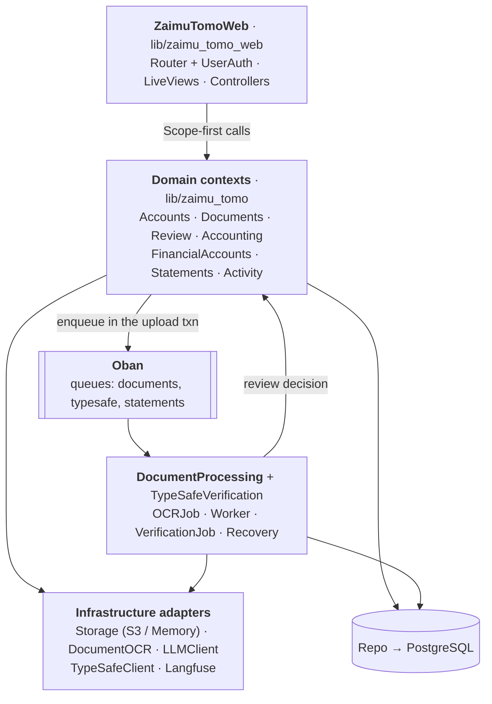

| Building block | Path | Responsibility |
|---|---|---|
| `Accounts` | `lib/zaimu_tomo/accounts*` | Users, sessions and tokens (phx.gen.auth), `Scope`, and per-user settings (display name, base currency). |
| `Documents` | `lib/zaimu_tomo/documents*` | Scoped document CRUD. Creates a document and its OCR job atomically, deletes the object after the row is deleted, and owns the fingerprint `FingerprintBackfill`. |
| `DocumentProcessing` | `lib/zaimu_tomo/document_processing*` | OCR → extraction pipeline (`OCRJob`, `Worker`), verification of each extraction (`VerificationJob`), processing state, live runs (`Run`), retry, stuck-document `Recovery`, and `ErrorClassification`. |
| `TypeSafeVerification` | `lib/zaimu_tomo/type_safe_verification*` | Optional shadow verification job on the `typesafe` queue. |
| `Review` | `lib/zaimu_tomo/review*` | One `ReviewDecision` per extraction (pending → approved / amended / rejected, each final; `failed` when extraction fails), the `EventLog` audit trail, and Langfuse feedback scores. |
| `Accounting` | `lib/zaimu_tomo/accounting*` | Journal entries from decisions, duplicate-invoice detection (`duplicate_check/3`: exact source file, invoice number, and field tuple), posting (category plus need/want; `list_categories/1` suggests the user's own earlier categories), tax deduction claims (set at posting, revised afterwards with `revise_tax_deduction_claim/3`), spending aggregates, and the journal ledger reads: unbooked entries for the booking queue, and posted entries per invoice month and year (`posted_journal_months/3`, `list_posted_journal_entries/4`), each narrowed by an optional case-insensitive text search over issuer, invoice number, category, description, and notes (the journal page's `?q=`), and posted entries by amount key for statement reconciliation (`list_posted_entries_for_amount_keys/2`). |
| `FinancialAccounts` | `lib/zaimu_tomo/financial_accounts*` | Accounts and balance snapshots, net worth by currency, and accounts grouped by type for the dashboard (`list_accounts_with_latest_balance_by_type/1`). The `account_type` enum (current, savings, cash, investment, credit card) is the one list of types: the account form reads its options from it. A current account is the everyday bank account that pays bills and receives salary. |
| `Statements` | `lib/zaimu_tomo/statements*` | Bank and card statements: upload (file and `ExtractJob` in one transaction, one statement per file per user), list, get one statement as its reconciliation (`get_reconciliation!/2` raises `Ecto.NoResultsError` for a missing or foreign id, `get_reconciliation/2` returns nil), retry, delete, the statement status rule (`status/2`), the balance check (`balance/1`), which statements may be read again (`retryable?/2`), the wording of a failure (`describe_failure/1`: a read that does not fit its account is worded here, every other code by `ErrorClassification.describe/1`), and `reconcile/2`, the only read of which journal entry backs which line. The only writer of `statements` and `statement_lines`. |
| `Activity` | `lib/zaimu_tomo/activity.ex` | A read model assembling each document's current workflow state and live run for the feeds. |
| `Storage` | `lib/zaimu_tomo/storage*` | Provider-neutral facade (`put/get/head/delete/read`) with S3 and in-memory adapters, plus migration and verification tooling. `store_upload/3` stores an uploaded file under a key prefix (`documents`) and fingerprints the same bytes. |
| `Fingerprint` | `lib/zaimu_tomo/fingerprint.ex` | Pure. The exact-byte SHA-256 of an uploaded file (`sha256/1`) and the format every stored digest must match (`format/0`). Outside every context so that `Storage`, `Documents`, `Accounting`, and `Statements` can share it without depending on each other. |
| `LLMClient` | `lib/zaimu_tomo/llm_client.ex` | Per-role (extractor and verifier) backend and model resolution through ReqLLM, and response parsing and validation. |
| `Langfuse` | `lib/zaimu_tomo/langfuse.ex` | Prompt fetch (with built-in local fallbacks), OpenTelemetry spans, and feedback scores. |
| `Release` | `lib/zaimu_tomo/release.ex`, `rel/overlays/bin/*` | Release-time commands: migrate, rollback, S3 migration and verification, stuck-document recovery, and the document fingerprint backfill. |

### Level 2 — document processing

| Module | Role |
|---|---|
| `DocumentProcessing.OCRJob` | Oban worker (`documents` queue, 5 attempts, 10-minute timeout, one live job per `document_id`, enforced by a partial unique index). Decides retry, failure recording, or cancellation. |
| `DocumentProcessing.Worker` | One attempt: download the object to a temp file → `DocumentOCR` → `LLMClient.extract_invoice` → persist. Persists success only, with its verification `pending` and a `VerificationJob` enqueued in the same transaction. |
| `DocumentProcessing.VerificationJob` | Oban worker (`documents` queue, 4 attempts, backoff 30 s, 2 min, 10 min, one live job per `extracted_content_id`). Sends one `LLMClient.verify_extraction` request per attempt from the row's OCR markdown, retries a transient failure and the first unreadable answer, and records the result once through `ExtractedContentContext.record_verification/2`. Never reruns OCR or extraction. |
| `DocumentProcessing.ErrorClassification` | Classifies each error as `:transient` or `:permanent`, produces bounded, body-free summaries, and describes a summary in plain words for the user (`describe/1`). |
| `DocumentProcessing.Run` | Read model of a document's live OCR job, built by `DocumentProcessing.live_runs/1`, or of its live verification job, built by `live_verification_runs/1`: the attempt running or next, the phase (queued, running, waiting to retry), the last failed attempt's failure code (`meta.last_error`), the next try, and the trigger (upload or Retry processing). |
| `DocumentProcessing.AttemptOutcomes` | Telemetry handler on Oban's job and plugin events that records what happened to an OCR or verification attempt once Oban has settled it. A failed attempt with a retry ahead stores its failure code in the job's `meta.last_error` and broadcasts `attempt_failed`. A final attempt Oban discards (raise, crash, job timeout, or a Lifeline discard) records the failed extraction. A run that could not record its failure broadcasts `failed`. For a `VerificationJob` it also counts unreadable verifier answers in `meta.invalid_outputs`, and a discarded final attempt records `verification_failed` on the row. |
| `DocumentProcessing.Recovery` | Finds documents with no extraction and no live job, and re-enqueues them. |
| `ObanFailureLogger` | Telemetry handler that logs failed attempts without payloads. |

### Level 2 — statement extraction

| Module | Role |
|---|---|
| `Statements.ExtractJob` | Oban worker (`statements` queue, 5 attempts, 10-minute timeout, one live job per `statement_id`, enforced by a partial unique index). One attempt: download to a temp file → `DocumentOCR.process/1` → `DocumentOCR.page_markdowns/1` → `LLMClient.extract_statement_page/2` once per page, in order → `ParsedStatement.from_pages/2` → persist. Its `persist/2` and `record_discarded/2` are the only writers of the extraction facts. |
| `Statements.AttemptOutcomes` | Telemetry handler on Oban's job exception and plugin stop events for discarded `Statements.ExtractJob` jobs. When Oban discards a final attempt (raise, crash, or job timeout) or `Oban.Lifeline` discards an interrupted final attempt, it delegates to `ExtractJob.record_discarded/2` to record `job_timeout`, `job_interrupted`, or `unclassified` and broadcast `{:statement_updated, id}`. |
| `Statements.ParsedStatement` | Pure. `parse_page/1` types one page of extractor output or refuses it. `from_pages/2` merges the pages, applies each line's sign once from its `direction`, and checks the currency and account reference against the account. The two references, uppercased and stripped to letters, digits, and mask characters, are compared right-aligned over the shorter one; a mask character (`X`, `*`, `•`, `·`, `●`) on either side matches anything, any other difference is an `account_mismatch`, and fewer than four unmasked characters to compare count as a match. So two full IBANs must be equal, and a masked card number matches an account that holds its last digits. Multi-page `account_ref` values are compared with the same reference matcher (keeping the most informative value) rather than strict equality. A line dated more than two months outside the period is a `line_outside_period`: a date printed without a year and read in the wrong year still balances, and this is what catches it. |
| `Statements.reconcile/2` | Read only, run on every page load. Loads the requested statements, closes over their amount groups across all the user's statement lines (a foreign-amount line has two keys and joins two groups; loop until no key is added), loads the posted entries under those keys with `Accounting.list_posted_entries_for_amount_keys/2`, and runs `Matcher.match/2` once. |
| `Statements.Matcher` | Pure. `line_keys/1` (a debit's account amount, plus its original amount for foreign spend; a credit has none), `entry_key/1`, `named?/2` (an issuer word in the description), and `match/2`: candidates share an amount key and fall within −7..+60 days of the invoice date, ranked named first, then by date distance (paying early counts triple), then folded greedily one-to-one. |
| `Statements.Reconciliation` | Read model of one statement: the statement, its status and balance, one row per line with its backing (`{:matched, entry, :named \| :amount_only}` or `:unbacked`), and a summary (`debits`, `debits_backed`, `credits`). `rows/2` filters by `:all`, `:backed`, `:unbacked` (debits), or `:credits`. |

---

## 6. Runtime view

### 6.1 Upload → extraction → review → journal entry

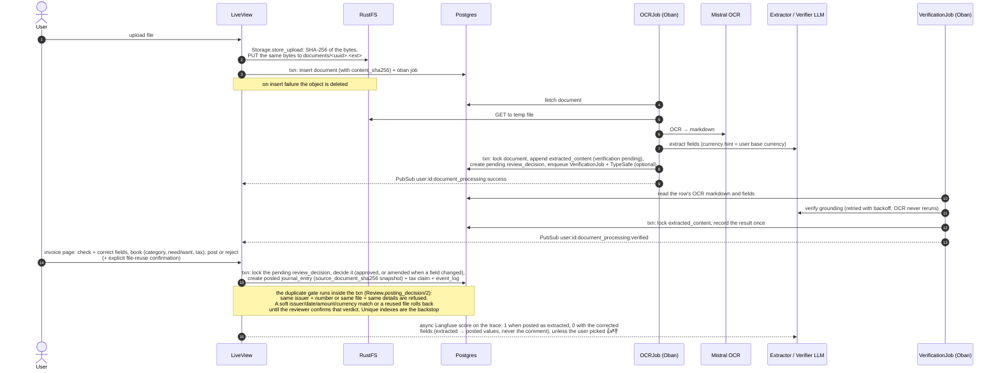

`/documents/:id` (`DocumentLive.Show`) is the single page for an invoice through
this whole flow: file preview, lifecycle steps, the check-and-book form, and,
once posted or rejected, a read-only summary with corrections (extracted value
struck through), the comment, the booking, and a history. `/documents` is the
inbox with *Needs action / Posted / Rejected / All* tabs. The old `/reviews`
URLs redirect there. Entries approved before booking was merged into posting are
still `uncategorized` and get a booking form on the same page.

The status shown for a document comes from one rule, `Review.document_status/2`,
on the document list, the dashboard feed and the `/activity` page (both through
`Activity`), and the invoice page: the OCR job queue decides `processing`,
`stalled`, or `failed`, and only a completed extraction is read for `review`,
`posted`, or `rejected`. The OCR worker broadcasts before Oban marks
the job complete, so a reload on that broadcast can still see the job running.
The invoice page and the `/activity` page therefore re-read the state every few
seconds while something is processing; `/activity` and the statement pages
schedule that re-read with one helper, `ZaimuTomoWeb.ProcessingRefresh.schedule/2`.

Whether a posting may go through is decided in one place, inside the posting
transaction: `Review.posting_decision/2` maps the duplicate verdict for the data
being posted and the reviewer's confirmation to post, ask for a confirmation, or
refuse. `approve_invoice/4` and `amend_invoice/5` take the confirmation as
`:confirm` and return `{:error, {:confirmation_required, verdict}}` when it is
missing, so no caller can post a soft match or a reused file unconfirmed. A
confirmation counts only for the verdict it names, and the same transaction
records it in `event_logs` with the matched entry IDs
(`possible_duplicate_confirmed` or `source_file_reuse_confirmed`). A user's postings are
serialized by a transaction-scoped advisory lock, so the check also sees a
posting made at the same moment. The invoice page renders the answer and offers
the confirmation the gate asks for.

A review is decided once. Approving, amending, and rejecting all go through one
transition, `ReviewDecision.decide_changeset/3`, applied to the review row while
it is locked: only a pending review can be decided, and the decision is final.
Of two decisions made at the same moment, the second finds no pending review.
A database trigger refuses any other change of status, whoever writes it, and a
second one refuses a review that is inserted already decided: a review starts
as pending, or as failed when extraction failed.

An entry is posted once. `Accounting.post_entry/6` locks the entry row and books
it only while it is `uncategorized`; a repeat (a stale tab, a replayed event,
the legacy backfill) returns `{:error, :already_posted}` and changes nothing. A
posted entry's category and need/want are final, and its tax treatment changes
only through the revision below.

After posting, the tax treatment stays editable: when the return is filed or
assessed, the user revises the claim on the journal entry page
(`TaxTreatmentComponents.tax_revision_form/1`). `Accounting.revise_tax_deduction_claim/3`
moves the claim along the lifecycle below (`TaxDeductionClaim.next_statuses/1`)
with a reason and the deductible amount, and writes the claim and a
`tax_deduction_claim_revised` event in one transaction,
with the journal entry row locked so concurrent revisions serialize. Saving an
unchanged claim logs nothing. An entry posted before tax claims existed has no claim; revising it creates one.

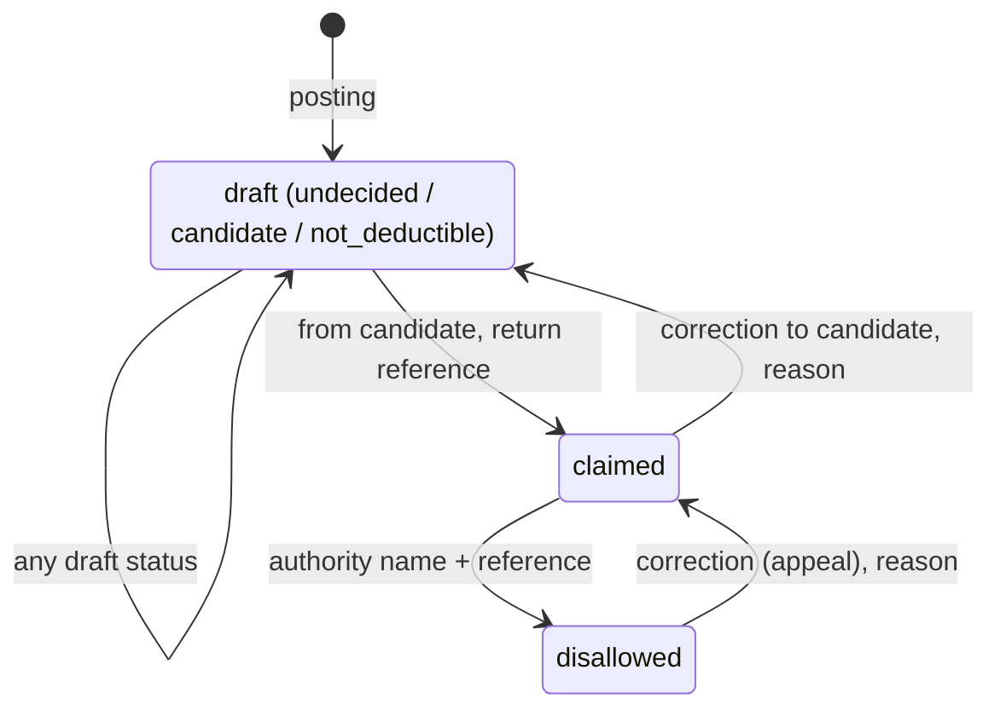

Corrections are flagged `correction: true` in the event. References that no
longer apply to the new status are cleared; the event records them as `from_`
values. A correction needs a reason different from the stored one, because
the form pre-fills the last reason.

### 6.2 Failure, retry and recovery

- **Transient error** (timeouts, 408, 429, 5xx, transport errors) on a non-final attempt: the job returns `{:error, summary}` and **persists nothing**. Oban backs off and retries. After Oban has stored the error and the `retryable` state, `AttemptOutcomes` stores the attempt's failure code in the job's `meta.last_error` and then broadcasts `user:<id>:document_processing:attempt_failed`, so a view that re-reads the job sees the failed attempt and why. The code comes from the exception Oban reports, never from its text (`AttemptOutcomes.failure_code/1`). An `{:error, code}` return keeps its `ErrorClassification.summarize/1` code, the job timeout is `job_timeout`, and a raise or crash is `unclassified`. A raise, a crash, or the job timeout on a non-final attempt is recorded and broadcast the same way.
- **Permanent error**, or a transient error on the final attempt (5): the job appends one `failed` `extracted_content` row and a `failed` review decision, broadcasts `user:<id>:document_processing:failed`, and completes.
- **Verifier failure never fails the document:** OCR and extraction end at the success row, whose `verification_status` starts `pending`. `VerificationJob` retries the verifier on its own: a transient failure (`ErrorClassification.classify/1`) before attempt 4 and the first unreadable answer go back to Oban, with failure codes that name the verifier (`verifier_request_failed:…`, `invalid_verifier_output`). A permanent failure, a second unreadable answer, attempt 4, a raise inside the job, a job timeout or Lifeline discard on attempt 4 (through `AttemptOutcomes`), and a refused job insert (`enqueue_failed`) all record `verification_failed` ("Could not verify" on the invoice page). It means a human checks the extraction; nothing automatic may treat it as a pass. The row keeps the attempt count (`attempts`) and the unreadable answers (`invalid_outputs`).
- **Raise, crash, or job timeout on the final attempt:** no job code runs after it, so Oban discards the job. `AttemptOutcomes` then writes the same failed row and decision through `Worker.persist_and_emit_failure/4`, which broadcasts `failed`. The row's message is the code described for the user ("The run took too long", "An unexpected error"), never the exception's text. The write keeps the supersede check, so a deleted document or a newer row records nothing. It also records nothing when a newer job is already live, because a Retry processing click can land between Oban's discard and this write. The retry would otherwise expect the row this write replaces and cancel itself.
- **Unrecordable failure:** when the failed row cannot be written, `OCRJob` cancels with `{:failure_not_recorded, summary}`. `AttemptOutcomes` then broadcasts `failed` without an `extraction_id`, as it does when its own failed-row write fails, so open views show the document as `stalled`, ready to retry.
- **Concurrency safety:** every terminal write locks the document row and checks that the latest extraction is still the one expected when the job was enqueued. Otherwise it cancels with `:already_processed`.
- **Crash or deploy mid-run:** `Oban.Lifeline` moves `executing` jobs back after 30 minutes. `AttemptOutcomes` records the lost attempt as `job_interrupted`. A rescued job waits for its next attempt with that reason and broadcasts `attempt_failed`. Lifeline commits the rescue before it reports it, so the reason is written only while the job is still `available` and its `attempted_at` is unchanged, and a newer attempt's reason is kept. A job on its final attempt is discarded and recorded as failed ("The run was interrupted").
- **User retry:** `DocumentProcessing.retry_document/2` re-enqueues documents in the `:failed` or `:stuck` state. The new run supersedes the old row, which stays as history. It reads the latest row and inserts the job while holding the document row lock that terminal writes take, so a discarded run's failure lands either before the read or not at all. Its job carries `meta.trigger = "manual_retry"` (other jobs carry `"upload"`). A successful enqueue broadcasts `user:<id>:document_processing:retried` so open views refresh.
- **Live run:** `DocumentProcessing.live_runs/1` reads each document's live OCR job as a `Run` in one query, from the job's state, attempt, schedule, and `meta` (`trigger` and `last_error`). `Run.retrying?/1` is true for a run the user started with Retry processing or one past its first attempt. A retrying document is still `processing`. Retry is detail on top of the status, never a status of its own.
- **UI state:** the documents Index and the processing hero derive each row's state from `DocumentProcessing.processing_states/1` (live job + latest extraction, two batched queries), the same semantics as `processing_state/1` on Show. A failed row with a live re-run keeps the failure note ("earlier run failed").
- **Retry display:** the dashboard feed, the documents Index, and the invoice page read `live_runs/1` too. When `Run.retrying?/1`, `status_pill` reads "Retrying" in the processing style, and `ZaimuComponents.retry_note/2` writes the one line all three surfaces show. An automatic retry reads "Attempt 2 of 5 · last try: the OCR service timed out · next try in under a minute", with the reason from `ErrorClassification.describe/1`. A run started with Retry processing reads "Retrying after a failed run · attempt 1 of 5". The invoice page also lists the earlier failed runs under "Earlier attempts". The feed dates a processing document by the later of its last change and its run's start. Retry processing starts a new run and moves the document to the top. An automatic retry reuses the job and leaves the document in place.
- **Verification retry display:** the invoice page also reads `live_verification_runs/1`, the same `Run` for the document's live `VerificationJob`. While the row is `pending` it shows "Verifying the extraction", or the `retry_note/2` line once an attempt failed ("Attempt 2 of 4 · last try: the verification service timed out · next try in 2 min"), and re-reads the row every few seconds while that job is live and the document is at "Check and book". It is a separate reader on purpose: `live_runs/1`, `processing_states/1`, and the "Retrying" pill read OCR jobs only, so a verifier retry never turns a document under review back into `processing`. Checking and posting stay available while the verifier works.
- **Operator recovery:** `bin/recover_stuck_documents` (see [operations.md](operations.md#stuck-documents)). `Recovery` enqueues through `DocumentProcessing.recover_stuck/2`, which rechecks the document under its row lock like Retry processing, so a document that gained a failed row or a live job since the sweep listed it is skipped.

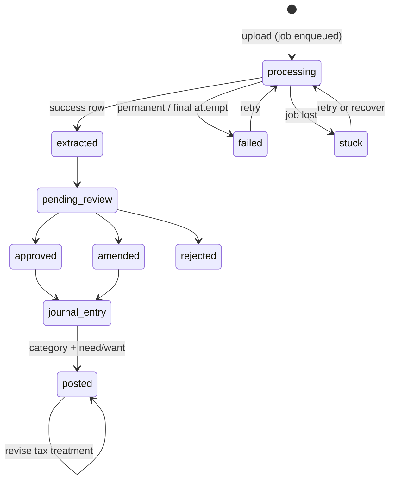

### 6.3 Statement upload and extraction

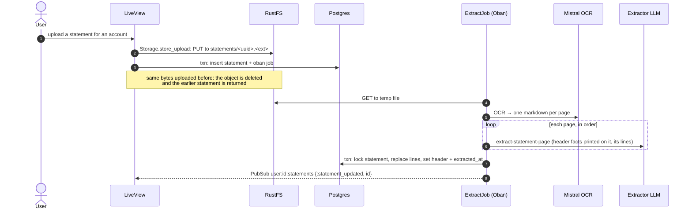

The extractor returns each line with a positive amount and a `direction`, and
`ParsedStatement.from_pages/2` applies the sign once: money out is negative,
card debt is a negative balance. A transient error on a non-final attempt
persists nothing and Oban retries. A permanent error, a transient error on the
final attempt, or a statement that does not fit its account (`currency_mismatch`,
`account_mismatch`, `inconsistent_header`, `missing_header`, `no_lines`,
`line_outside_period`, `duplicate_period`) sets `failure_code` and keeps the earlier read, if any.
A final attempt Oban discards on a crash, timeout, or `Oban.Lifeline`
interruption is recorded the same way by `Statements.AttemptOutcomes` through
`ExtractJob.record_discarded/2` (`unclassified`, `job_timeout`, or
`job_interrupted`), keeping any earlier read and broadcasting
`{:statement_updated, id}`.
Retry only enqueues a job. Deleting a statement deletes its row and lines,
then its file; a job still queued for it cancels itself.

`/statements` (`StatementLive.Index`) lists statements by account with their
status and period, and `/statements/new?account=<id>` opens the upload panel
with that account chosen; each account page links to both. `/statements/:id`
(`StatementLive.Show`) shows the account, period, opening and closing
balances, whether the lines add up (balanced, or off by an amount), the status
with the failure in plain words (`Statements.describe_failure/1`), the lines,
and the Read again and Delete actions. Read again is offered only where
`Statements.retryable?/2` allows it. Both pages subscribe to
`user:<id>:statements` before their first read and reload on it and, like the
invoice page, re-read every few seconds while a statement is processing,
because the job broadcasts before Oban marks it complete. A statement deleted
while its page is open, by its own Delete or elsewhere, sends the page back to
`/statements`.

**Backing.** Each payment line on `/statements/:id` shows the posted journal
entry that backs it (issuer and invoice date, linked to `/journal_entries/:id`),
"Same amount, check" in a quieter style when only the amount and date fit, or
"Not backed". A coverage meter reads "41 of 52 payments backed", and the tabs
All, Not backed, Backed, and Credits filter the lines through `?filter=`, so
back and refresh keep the tab. `/statements` shows "backed 41/52" per read
statement from one `reconcile/2` call for the whole list. Nothing is stored:
both pages call `Statements.reconcile/2` on every load and re-run it on
`invoice_review:completed` for their user (an invoice approved with a booking
is posted in that transaction) and on any `user:<id>:statements` event,
because another statement's read can take or free an entry in a shared
amount group. Credits are listed but never matched.

### 6.4 TypeSafe shadow verification (optional)

When `TYPESAFE_API_KEY` is set, the success transaction also enqueues a
`TypeSafeVerification.Worker` job on the `typesafe` queue, isolated by a
savepoint so an enqueue failure never rolls back the extraction. The job re-reads
the OCR markdown from the stored row; job args never contain financial text. It
writes per-field error probabilities to
`extracted_content.analysis.verification.typesafe_shadow` and never changes the
authoritative verification result. It is fail-open: provider errors are recorded
on the row and the job completes. `put_typesafe_shadow/2` and
`record_verification/2` both write `analysis` holding the row lock
(`FOR UPDATE`), so the shadow and the verifier never overwrite each other's
keys. The shadow does not read the verifier's result, so the two jobs run in
any order.

---

## 7. Deployment view

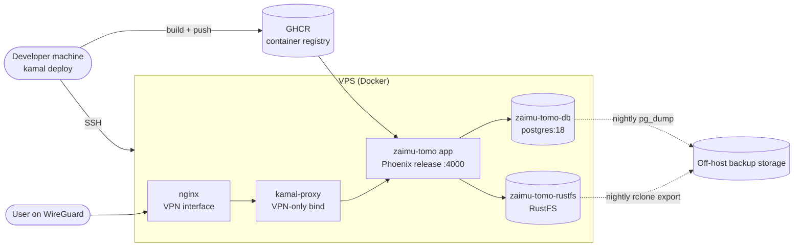

| Environment | How it runs |
|---|---|
| Local dev | `docker compose` for Postgres and RustFS, then `mix phx.server`. Local LLMs (FastFlowLM or Ollama) or cloud backends. |
| Test / CI | GitHub Actions (`.github/workflows/ci.yml`): Postgres service, `mix compile --warnings-as-errors`, `mix test`. The in-memory storage adapter and Oban `testing: :manual` are used. RustFS integration tests are opt-in (`RUN_INTEGRATION=true`, Testcontainers). |
| Amp orb | `.agents/setup` and `.agents/resume` prepare a disposable dev sandbox (orb only, never production). |
| Production | Kamal 2 on a single VPS, as above. Details: [deployment.md](deployment.md). |

---

## 8. Crosscutting concepts

### Data model

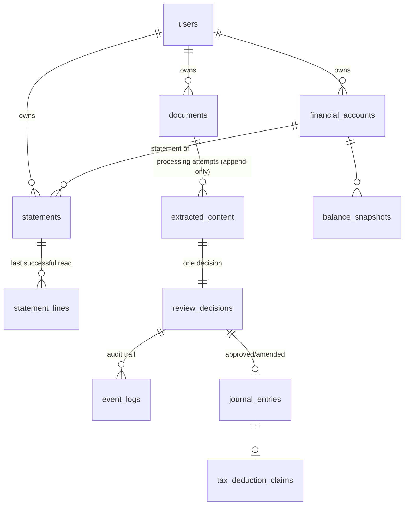

- `documents` stores `filename` (original name), `object_key` (`documents/<uuid>.<ext>`), and `content_sha256` (SHA-256 of the exact uploaded bytes, lowercase hex; null for legacy rows until the backfill reads them). The bytes live only in object storage. Replacing the object replaces the digest.
- `extracted_content` holds `extracted_data` (an embedded schema), `raw_llm_response`, an `analysis` map (verification detail and TypeSafe shadow results), `verification_status` (see the state machine below), `status` (`success` or `failed`), `error_details`, and the Langfuse `trace_id`.
- `extracted_content.verification_status` is `pending`, `verified`, `needs_review`, `rejected`, or `verification_failed` on a success row and null on a failed one (check constraint `extracted_content_verification_status_check`). The `BEFORE INSERT` trigger `extracted_content_guard_verification_initial_status` lets a row start only as pending or null, and the `BEFORE UPDATE` trigger `extracted_content_guard_verification_transition` allows a change only from pending to an end state. The detail (`reason`, `field_issues`, `error`, `attempts`, `invalid_outputs`, `verifier_model`, `prompt_version`) stays in `analysis.verification`. Rows from before the column took their analysis status; a success row without a known status became `verification_failed`.
- Money is stored in integer cents with an ISO currency code. Each user has a `base_currency` (default CHF), which is snapshotted into each OCR job as the currency hint.
- `oban_jobs` lives in the same database. Finished jobs are pruned after 7 days.
- Deleting a document that has a posted journal entry is blocked by a foreign key.
- `review_decisions.review_status` changes only through `ReviewDecision.decide_changeset/3`: pending → approved, amended, or rejected, and nothing leaves those or `failed`. `Review` decides a row it holds locked (`FOR UPDATE`) inside the transaction that also writes the event log, so concurrent decisions on one review have one winner. Check constraints restrict the status to the five known values and require a non-blank `rejection_reason` on a rejected row. Two triggers enforce the machine for every writer, including raw SQL. `review_decisions_guard_transition` enforces the transition rule: an update that changes the status in any other way fails as a check violation named `review_decisions_transition_check`, which `decide_changeset/3` reports as an error on `review_status`. `review_decisions_guard_initial_status` enforces the starting states: an insert in any status but pending or failed fails as a check violation named `review_decisions_initial_status_check`, and `changeset_for_create/1` validates the same. Updates that leave the status alone and deletes are not affected. An insert trigger runs before check constraints, so an unknown status is refused by it first and the status check is a backstop.
- `tax_deduction_claims` has at most one row per journal entry; entries posted before the table existed have none until a revision creates it. Posting accepts only the draft statuses `undecided`, `candidate`, and `not_deductible`; a revision of a posted entry follows the lifecycle in §6.1 to `claimed` (included in the tax return; `tax_return_reference` required) and `disallowed` (refused by the tax authority; `authority_name` and `authority_reference` required, return reference kept). Check constraints enforce the required references in the database. `not_deductible` and `disallowed` always store a deductible amount of 0; otherwise a revised amount lies between 0 and the entry amount (negative for a credit note). `notes` holds the latest revision reason (up to 255 characters). The history lives in `event_logs`: each `tax_deduction_claim_revised` event (`invoice_id` = journal entry ID) records `from_status`/`to_status`, `from_deductible_amount_cents`/`to_deductible_amount_cents`, `tax_year`, `reason`, `correction`, and the old and new value of each reference (`from_`/`to_tax_return_reference`, `from_`/`to_authority_name`, `from_`/`to_authority_reference`).
- A partial unique index on `journal_entries (user_id, lower(btrim(issuer)), lower(btrim(invoice_number)))` blocks posting the same numbered invoice twice per user. An unnumbered invoice matching an existing entry's exact `(issuer, date, amount, currency)` tuple is a soft match that requires explicit reviewer confirmation to post. No index covers a soft match. The duplicate gate in the posting transaction enforces it under a per-user advisory lock (§6, D21), and logs the confirmation as a `possible_duplicate_confirmed` event with the matched entry IDs (D24). See `Accounting.duplicate_candidates/2`.
- A partial unique index on `oban_jobs ((args->>'document_id'))`, limited to `OCRJob` jobs in a live state (`available`, `scheduled`, `executing`, `retryable`), allows one live OCR job per document. Oban's own unique check is an advisory lock and a select, which two concurrent enqueues can both pass. Retry processing and Recovery already serialize on the document row lock, so the index is the backstop for any other path. `DocumentProcessing.ocr_job/4` declares the index as a constraint, so a refused insert is an error, not an exception: Recovery skips the document and `retry_document/2` returns `{:not_retryable, :processing}`.
- `journal_entries.source_document_sha256` is an immutable posting-time copy of the source document's `content_sha256`; `source_file_reuse_confirmed` (default false) marks a posting the reviewer explicitly confirmed as a reuse of the same file. The partial unique index `journal_entries (user_id, source_document_sha256) WHERE source_document_sha256 IS NOT NULL AND NOT source_file_reuse_confirmed` allows one unconfirmed posting per file per user. `Accounting.duplicate_check/3` ranks matches as same file > invoice number > same details; a file match is confirmable only when no field rule also matches (the tuple is compared against the file-matched entries even for numbered invoices). No index covers a confirmed reuse. The same gate checks its "no field match" condition under the same lock. Confirmations are logged as `source_file_reuse_confirmed` events with the matched entry IDs. Fingerprints are user-scoped, redacted from inspect output, and never rendered or sent to an AI provider. Only `FingerprintBackfill` may set them on existing entries, and only where the digest is missing. The `BEFORE UPDATE` trigger `journal_entries_guard_fingerprint` enforces this for every writer. An update may set both columns only while the digest is null, and only to a digest. Once a digest is set, a change to either column fails as a check violation named `journal_entries_fingerprint_immutable_check`.

- `statements` stores the upload (`filename`, `object_key` under `statements/`, `content_sha256`, unique per user) and the facts of the last successful read: `extracted_at`, `account_ref`, `period_start`/`period_end`, `currency`, `opening_balance_cents`, `closing_balance_cents`, all signed from the holder's side. `failure_code` is the last failed run's code, cleared by a success. `financial_account_id` is required, and a composite foreign key `(financial_account_id, user_id)` → `financial_accounts (id, user_id)` (`ON DELETE RESTRICT`) enforces same-user ownership and ensures `FinancialAccounts.delete_financial_account/2` returns an error on `:statements` ("delete its statements first") for an account that still has statements. The bidirectional check `statements_extracted_header` requires all header columns (including `account_ref`) to be null while `extracted_at` is null and the full header (with `period_start <= period_end`) once `extracted_at` is set; additional checks enforce the `statements/` object key prefix, 64-char lowercase hex `content_sha256`, 3-letter uppercase ISO `currency` when set, and non-empty `failure_code`, while `statements_one_per_account_period` allows one statement per account and period. Two triggers enforce lifecycle invariants for every writer: `statements_guard_initial_state` (`BEFORE INSERT`) rejects inserts with `extracted_at` or `failure_code` set (`statements_initial_state_check`), and `statements_guard_invariants` (`BEFORE UPDATE`) forbids changing `user_id`, `financial_account_id`, `object_key`, or `content_sha256` (`statements_upload_immutable_check`) or clearing `extracted_at` once set (`statements_extracted_at_monotonic_check`). `statement_lines` (`position`, `booking_date`, `value_date`, `description`, signed `amount_cents` in the statement currency, optional `original_amount_cents` + `original_currency` for foreign card spend) are replaced wholesale by each successful read and copy `user_id` and `currency` for the `(user_id, currency, amount_cents)` index; a composite foreign key `(statement_id, user_id, currency)` → `statements (id, user_id, currency)` (`ON DELETE CASCADE`) ties each line to an extracted statement's owner and currency, and checks enforce `position >= 1`, non-zero `amount_cents`, paired non-zero `original_amount_cents`/`original_currency` matching the sign of `amount_cents`, and 3-letter uppercase ISO codes on both currencies. A partial unique index on `oban_jobs ((args->>'statement_id'))` allows one live `ExtractJob` per statement, like the OCR job index.
- Which journal entry backs a statement line is computed on read by `Statements.reconcile/2`, never stored. Its lookups are by amount key: `statement_lines (user_id, currency, amount_cents)` and the partial `(user_id, original_currency, original_amount_cents) where original_currency is not null` for the amount-group closure, and `journal_entries (user_id, currency, amount_cents)` for the posted entries under those keys. (D37)

### State machines

Seven things have a status with rules about how it may change. Each rule lives in
one function. To change a rule, change that function. Do not add a second place
that writes the status.

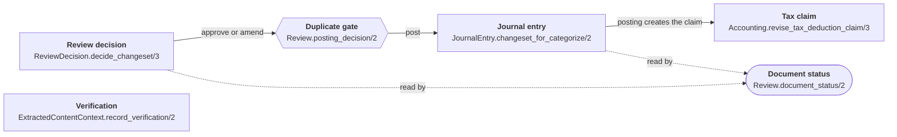

**Document status** is shown, never stored. Every screen asks the same function.
There is no column, so there is nothing for the database to guard. (D20)

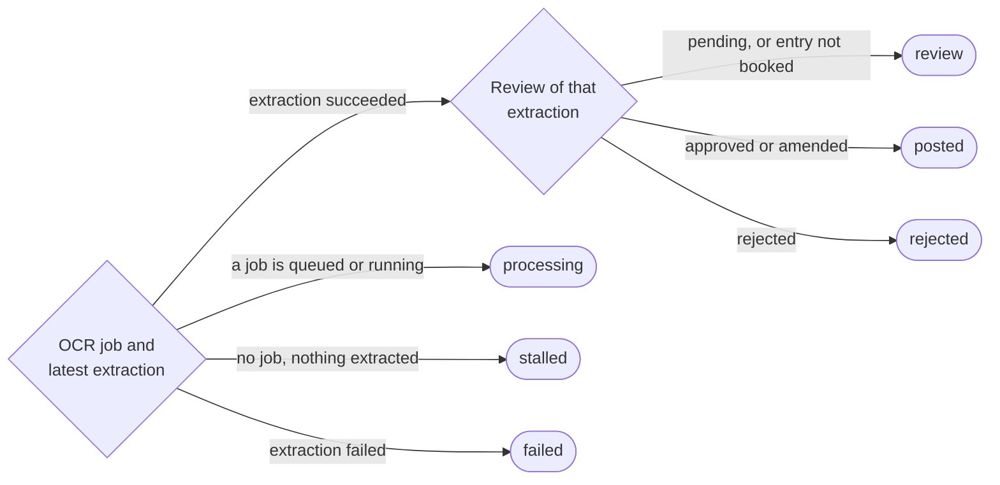

**Statement status** is shown, never stored, like the document status. Every
screen asks `Statements.status/2`. `ExtractJob` (`persist/2` and
`record_discarded/2`) is the only writer of the facts it reads (`extracted_at`,
`failure_code`), under the statement row lock that retry and delete take too.
When a final attempt is discarded by Oban on a crash or timeout, or by
`Oban.Lifeline` after a node dies, `Statements.AttemptOutcomes` calls
`ExtractJob.record_discarded/2` to record `failure_code` (`job_timeout`,
`job_interrupted`, or `unclassified`), keeping any earlier read and broadcasting
`{:statement_updated, id}` (unless a manual retry already started a live job or
the statement was deleted). Retry only enqueues a job. (D36)

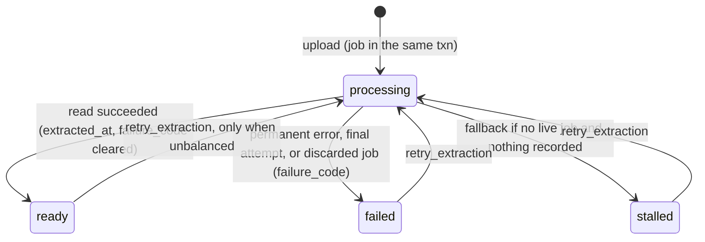

A live job is `processing`. Otherwise a failure code is `failed`, even over an
earlier read whose lines stay shown, a read is `ready`, and `stalled` remains
the fallback if nothing was recorded and no live job exists. Whether a ready
read balances (`Statements.balance/1`) is derived on read, never stored.

**Review decision** (`review_decisions.review_status`). A review is decided
once, on a locked row. Nothing leaves `approved`, `amended`, `rejected`, or
`failed`. Two triggers refuse any other start or move, whoever writes it. Check
constraints limit the values and require a reason on a rejection. (D22, D23,
D25)

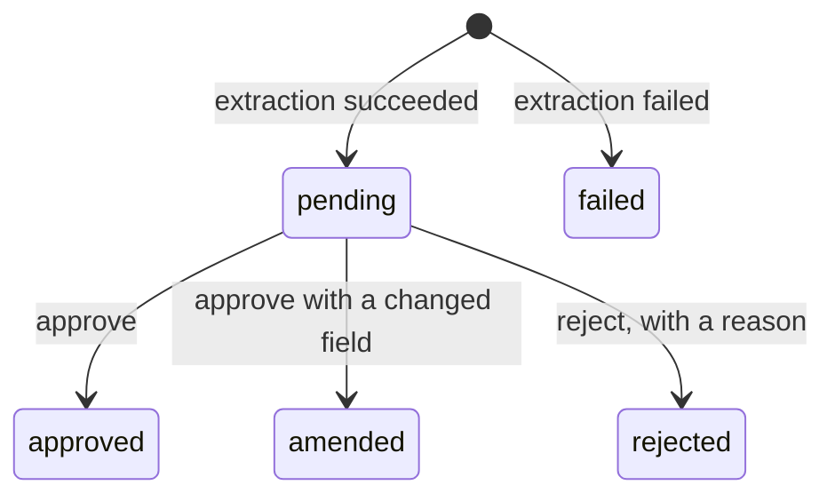

**Duplicate gate** is an answer, not a stored status. It runs inside the posting
transaction, on the data being posted. A confirmation counts only for the match
it names; one that names another match is refused. Two unique indexes stop the
two refusals below. No index covers an "ask" case. The posting transaction is
the only path that creates journal entries, and a per-user advisory lock
serializes it, so the gate sees every earlier posting. (D10, D21, D24)

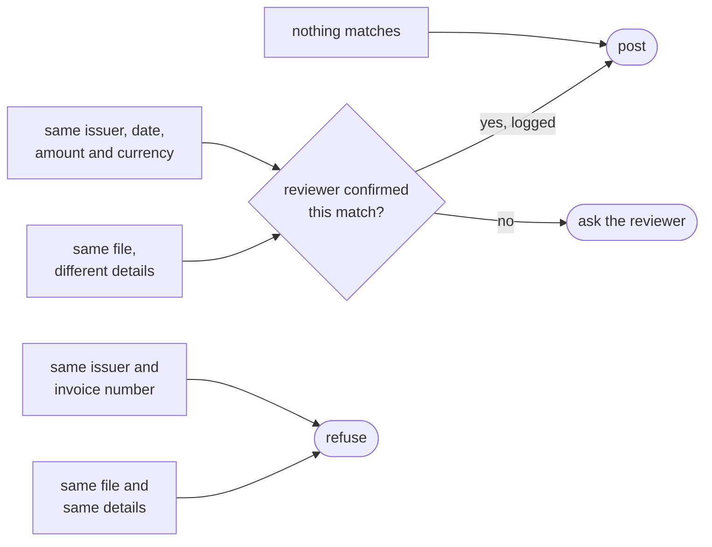

**Journal entry** (`journal_entries.status`). An entry is posted once. Approval
creates and posts it in one transaction: it inserts the entry uncategorized and
then posts it. `Accounting.post_entry/6` posts an older entry on a locked row
and returns `:already_posted` on a repeat. Two triggers refuse any other start
or move, whoever writes it. An insert in any status but `uncategorized` fails as
`journal_entries_initial_status_check`. A status change other than
uncategorized → posted fails as `journal_entries_transition_check`. A check
constraint limits the values. (D17, D19, D30)

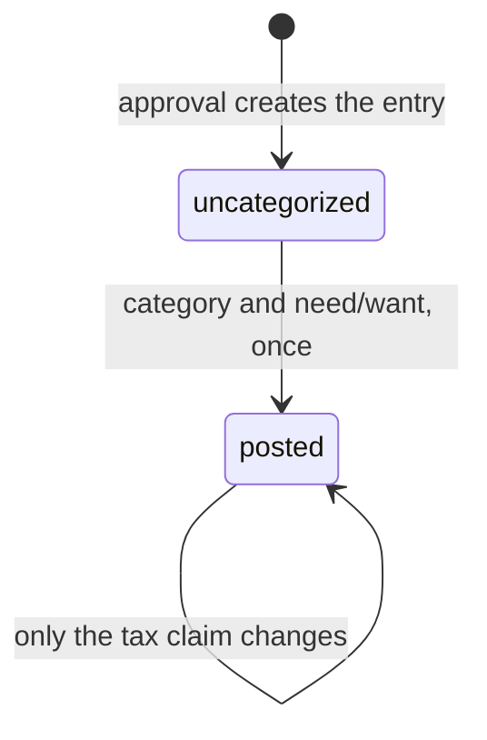

**Verification** (`extracted_content.verification_status`). A success row
starts `pending`, set by the insert in `Worker.persist_and_emit_success/6`, and
moves once to an end state through `ExtractedContentContext.record_verification/2`,
which holds the row locked and writes only while it is `pending` (a second
writer gets `:already_recorded`; any other failed write raises, so the job retries and is not left `pending`). A failed row has none. A check constraint
limits the values and ties null to failed rows; two triggers refuse any other
start or move, whoever writes it (`extracted_content_verification_initial_status_check`,
`extracted_content_verification_transition_check`). Only `verified` may ever
count as a pass; `verification_failed` means a human checks the extraction.
(D35)

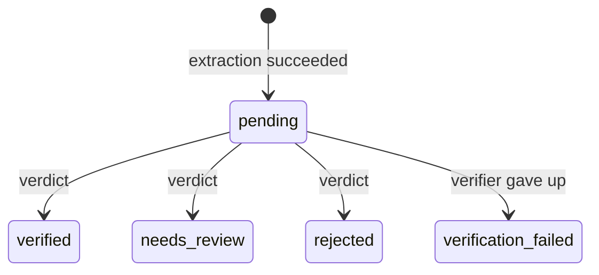

**Tax claim** (`tax_deduction_claims.status`). The diagram is in §6.1. Posting
sets one of `undecided`, `candidate`, or `not_deductible`. After that only
`Accounting.revise_tax_deduction_claim/3` changes it, and
`TaxDeductionClaim.next_statuses/1` lists the allowed moves. Check constraints
limit the values and require the references. They do not check the order of
moves. (D18, D19)

A new status or move needs four changes: the function, the database guard if the
row has one, the picture here, and a row in §9.

### Multi-tenancy and authorization

Every context function takes `%Accounts.Scope{}` first and filters by
`scope.user.id`. Routes requiring login live in `live_session :require_authenticated_user`.
Unscoped functions exist only for maintenance tasks (storage verification,
stuck recovery, fingerprint backfill) and say so in their docs.

### Background jobs (Oban)

| Queue | Worker | Concurrency (env) | Attempts | Notes |
|---|---|---|---|---|
| `documents` | `DocumentProcessing.OCRJob` | `OBAN_DOCUMENTS_CONCURRENCY` (2) | 5 | One live job per document: Oban's unique check, backed by the partial unique index `oban_jobs_one_live_ocr_job_per_document`. 10-minute timeout. `meta.trigger` is `upload` or `manual_retry`. `meta.last_error` is the failure code of the last failed attempt, written by `AttemptOutcomes`. |
| `documents` | `DocumentProcessing.VerificationJob` | shares `OBAN_DOCUMENTS_CONCURRENCY` | 4 | One live job per `extracted_content_id` (Oban's unique check; the pending-only write makes a duplicate harmless). Backoff 30 s, 2 min, 10 min; timeout `AI_VERIFIER_RECEIVE_TIMEOUT` + 30 s. A job waiting to retry holds no slot. `meta.last_error` and `meta.invalid_outputs` are written by `AttemptOutcomes`. |
| `typesafe` | `TypeSafeVerification.Worker` | `TYPESAFE_MAX_CONCURRENCY` (2) | 3 | Fail-open shadow run. |
| `statements` | `Statements.ExtractJob` | `OBAN_STATEMENTS_CONCURRENCY` (1) | 5 | One live job per statement: Oban's unique check, backed by the partial unique index `oban_jobs_one_live_extract_job_per_statement`. 10-minute timeout. One extractor call per page. |

Plugins: `Oban.Pruner` (7 days) and `Oban.Lifeline` (30 minutes, which must exceed
the OCR timeout). Rules: job args are self-contained commands resolved at
enqueue time, and they never carry document text or provider payloads.

### AI pipeline configuration

OCR always uses Mistral. The extractor and verifier each take an explicit
`backend` (`nousresearch | mistral | flm | ollama`) and `model`. There is no
fallback. Prompts (`extract-invoice`, `verify-extraction`, `extract-statement-page`) come from Langfuse
(label `production`) when Langfuse is enabled, and from built-in local templates
otherwise. The local templates are copies of the production versions
(`extract-invoice` v2, `verify-extraction` v2): when a new version goes to
`production`, copy it into `ZaimuTomo.Langfuse` too, or Langfuse-off
environments run older rules. See [local-ai.md](local-ai.md) and [configuration.md](configuration.md).
`extract-statement-page` runs on the extractor role, once per statement page,
with a ReqLLM schema whose `lines` is a list of objects. The model returns each
line's amount as a positive number with a `debit`/`credit` direction, and
`Statements.ParsedStatement.parse_page/1` types the answer or refuses it with
`{:validation_failed, fields}`. Pages are read in order, and each request after
the one that prints the statement period carries it in `{{period}}` (`none yet`
before that), so a date printed without a year gets the period's year. A
Langfuse-hosted `extract-statement-page` must use the same variables as the
local template.

### Observability

- **Tracing:** OpenTelemetry spans per document (`process-invoice` → extraction, verification, TypeSafe shadow), exported to Langfuse when it is enabled. The trace ID is stored on the extraction, so user 👍/👎 feedback becomes a Langfuse score.
- **Logs:** tagged prefixes (`[OCR]`, `[TypeSafe]`). Failures are logged as bounded summaries, never as OCR text or provider bodies. The default formatter includes the request ID and TypeSafe status, model, error class, and sanitized stacktrace metadata; development keeps its message-only format.
- **Health:** `GET /health` and `/up` (no session or auth), used by kamal-proxy and the Docker `HEALTHCHECK`.
- **LiveDashboard:** dev only (`/dev/dashboard`).

### Security and privacy

- VPN-only exposure, private bucket, and app-mediated preview and download (`DocumentController`, inline only for PDFs and images).
- Secrets come from environment variables at runtime (`config/runtime.exs`), supplied by Kamal from `.kamal/secrets`, which is not committed.
- Financial text is kept out of `oban_jobs`, logs, and error summaries.

### Real-time UI

PubSub topics: `user:<id>:documents`, `user:<id>:document_processing:success|failed|retried|attempt_failed|verified`
(`attempt_failed` is sent for OCR and verification attempts),
`invoice_review:completed`, `user:<id>:financial_accounts`, and `user:<id>:statements`
(`{:statement_updated, id}` after an upload, a retry, or a read; `{:statement_deleted, id}`). LiveViews
subscribe in `mount/3` when connected. The statement pages also listen to `invoice_review:completed`,
filtered to their user, to re-run `Statements.reconcile/2` after a posting.

Account settings renders inside the authenticated `zaimutomo` root layout.
Its `Layouts.app` call uses `shell: :product` to render content and LiveView
flash messages without duplicating the standalone authentication navigation.
Profile, email, and password remain independent forms; sensitive changes still
require a recent login. Settings styles are scoped to avoid altering other pages.

The login page (`UserLive.Login`, `/users/log-in`) and the magic-link page
(`UserLive.Confirmation`, `/users/log-in/:token`) render under the standalone
`root` layout with `Layouts.app shell: :bare`, so they bring their own
full-page chrome: the shared dark brand panel `ZaimuComponents.auth_stage/1`
beside a "sign-in slip" form. Their styles live in `assets/css/login.css`, and
the `root` layout loads the same Geist and Instrument Serif fonts as the
`zaimutomo` layout. Both pages use a single "Keep me signed in" checkbox:
checking it posts `remember_me=true`, which makes `UserAuth` write the
remember-me cookie; leaving it unchecked logs in for the browser session only.

### Testing

ExUnit with the SQL sandbox. Storage uses the Memory adapter, HTTP uses
`Req.Test` stubs, and Oban runs in manual testing mode. Run `mix precommit`
before committing (compile with warnings as errors, unlock unused deps, format,
test), plus `mix credo --strict`, which is blocking in CI (§9 D15).

---

## 9. Architecture decisions

Short decision records, newest last. Add one when a change alters structure,
infrastructure, or a cross-cutting rule. Older, longer feature-level reasoning
is in [`specs/`](../specs/README.md).

| # | Date | Decision | Why / consequences |
|---|---|---|---|
| D1 | 2026-01 | Phoenix LiveView monolith with phx.gen.auth scopes | One deployable, server-rendered real-time UI. All data is scoped per user. |
| D2 | 2026-03 | Persist every extraction attempt as a row; one review decision per extraction | Keeps history, and humans approve before booking. See `specs/001`, `specs/002`. |
| D3 | 2026-05 | Journal entries only from approved or amended decisions | AI never writes to the books directly. |
| D4 | 2026-06 | Kamal 2 on a single VPS, app reachable only over WireGuard | Low cost, private by default. Postgres runs as a Kamal accessory. |
| D5 | 2026-08 | Per-role LLM backends (extractor and verifier) selected by env, with no fallback | Models can be swapped or mixed (local and cloud) without code changes. Misconfiguration fails loudly. |
| D6 | 2026-08 | Document bytes in S3-compatible storage (self-hosted RustFS), with a provider-neutral `Storage` facade | Decouples bytes from the release. A later provider switch is config only. See `specs/003`. |
| D7 | 2026-09 | TypeSafe Jev as a *shadow* verifier | Collects independent per-field error probabilities without affecting outcomes until it is trusted. |
| D8 | 2026-09 | Replace fire-and-forget `Task` OCR with durable Oban jobs, enqueued in the upload transaction | Uploads can't lose their job. Retries, Lifeline rescue, user retry, and operator recovery. The TypeSafe shadow also moved to Oban. |
| D9 | 2026-10 | Add `stream_data` (test-only) for property-based tests on pure, boundary-heavy logic (currency normalization, error-retry classification, changeset validity, aggregation sums) | Generates and shrinks adversarial inputs instead of relying only on hand-picked examples; already caught an Ecto blank-string edge case in `Currency.normalize_and_validate/2`. DB-backed properties cap `max_runs` explicitly to bound CI time; `config :stream_data, max_runs` is lower locally, higher in CI (`CI=true`, set by GitHub Actions by default). |
| D10 | 2026-08 | Duplicate invoice detection: DB-enforced unique index, plus the journal entry in the same transaction as the review decision | A numbered invoice (same user, issuer, invoice number) cannot post twice; the database enforces it regardless of code path. An unnumbered exact `(issuer, date, amount, currency)` match warns and needs explicit confirmation. Posting the journal entry, tax claim, and event log now happens in the same `Ecto.Multi` as the decision update, so a duplicate or a failed audit write rolls the whole transition back — closing the gap in §11. |
| D11 | 2026-10 | Exact-byte SHA-256 fingerprints as an OCR-independent duplicate signal, copied to the journal entry at posting and enforced by a per-user partial unique index over unconfirmed postings | Re-uploading identical bytes is caught even when OCR/LLM reads different fields. A unique constraint cannot span document → extraction → review → entry, so the digest is snapshotted on the entry. Legitimately reused files (QR-bills, standing slips) post only with an explicit per-posting confirmation, recorded on the entry and in the event log. Legacy rows are filled by an online, idempotent backfill through the `Storage` facade, never by a migration. See `specs/004`. |
| D12 | 2026-10 | Upgrade to Elixir 1.20 (OTP unchanged at 28) | Elixir 1.20 completes zero-annotation type inference across all constructs, so the existing `mix compile --warnings-as-errors` CI gate now also catches unreachable clauses and dead code for free, no specs or Dialyzer required. Surfaced and removed 3 pre-existing dead branches (`review.ex`, `llm_client.ex`, `langfuse.ex`) that the 1.19 compiler couldn't see. First step toward the CI reliability work tracked for direct-to-main pushes; a complementary nightly Dialyzer job (whole-program success typing) is still planned separately. |
| D13 | 2026-10 | Split CI into `lint` / `test` / `security-audit` jobs; `mix credo --strict` and `mix hex.audit` run on every push but are advisory (non-blocking), with a separate nightly workflow re-running the audit so a CVE disclosed on a quiet day still gets caught | First step of hardening CI as the real safety net for pushing straight to `main` with less manual review. Credo and the audit aren't required checks yet because both already have a pre-existing backlog (51 Credo issues; `hackney` pinned to a vulnerable 1.x line by a test-only dependency) unrelated to any one change — see §11. `mix hex.audit` found 6 live advisories in locked dependencies; the `bandit` ones were fixed by a routine version bump in the same change, `hackney`'s needs a dependency change tracked separately. |
| D14 | 2026-10 | Add Dialyzer (dialyxir) as a nightly, advisory-only CI job rather than a required per-push check | Whole-program success typing complements the Elixir 1.20 compiler's own type inference (D12) by also checking across the OTP/dependency boundary, but PLT builds are too slow for a per-push gate. First run found 10 findings: 3 duplicated dead code already fixed by the Elixir 1.20 upgrade; 5 are a well-known Dialyzer/`Ecto.Multi` opaque-`MapSet` false positive; 2 (`storage/s3.ex`) are a `File.stream!/2` success-typing gap verified benign directly in `iex` before suppressing. All 7 non-duplicate false positives are listed individually in `.dialyzer_ignore.exs` with the reasoning, not blanket-ignored, so a genuinely new finding in the same file still surfaces. Also added missing `@type t :: %__MODULE__{}` to `ExtractedData` and `ExtractedContent.ExtractedContent` (matching the convention already used in `Document`/`ReviewDecision`), which cleared 9 separate `unknown_type` findings and makes every existing `@spec` referencing them actually checked going forward. |
| D15 | 2026-10 | Clear the 51-finding Credo backlog and make `mix credo --strict` blocking in the existing `lint` CI job | Supersedes D13's advisory Credo policy so new findings fail CI instead of rebuilding the backlog. Reorder aliases, alias nested module calls, use implicit function-level rescue/catch and readable string sigils, use `ReviewDecision.t()` in specs, and configure the existing TypeSafe Logger metadata explicitly. The two upload-test TODOs were stale: the same file already exercises uploads and edit submission, so replace them with references to that coverage. No checks are disabled and no findings are suppressed. Security audit and nightly Dialyzer remain advisory; GitHub branch protection settings are unchanged. |
| D16 | 2026-10 | Pin every workflow job to `runs-on: ubuntu-26.04` instead of `ubuntu-latest` | GitHub migrated the `ubuntu-latest` label from Ubuntu 24.04 to 26.04 gradually between October 19 and November 19, 2026, so two runs of the same commit could land on different images with no repo change. Pinning makes the toolchain that a green build was verified against explicit and reproducible, and turns the next image adoption into a deliberate commit rather than a silent rollover. `ubuntu-26.04` is GA on x64, and all five jobs only need Docker, the Postgres service container, and `erlef/setup-beam`'s Elixir/OTP builds, which the new image supports. |
| D17 | 2026-11 | One invoice page (`/documents/:id`) replaces the review, amend, and journal-entry posting screens, so it is the only place an entry is booked; checking and booking are one transaction. `/documents/:id/edit` remains and only replaces the stored file | The flow split one invoice over three pages that did not link to each other, so a treated or amended invoice was hard to find again. `Review.approve_invoice/4` and `amend_invoice/5` take `:booking` and `:tax_claim_attrs`, and `Accounting.create_multi_from_decision/3` posts the entry inside the existing review transaction, so a booking error rolls back the whole posting like a duplicate does. One comment per invoice (stored as review notes and copied to the entry's notes). Extraction feedback is sent automatically on posting so Langfuse gets a signal for every posted invoice. A rejection sends a score only when the user picked 👍/👎, because a correctly read duplicate is rejected too. |
| D18 | 2026-11 | Tax claims follow an explicit lifecycle: drafts move freely, `candidate` → `claimed` needs a tax return reference, `claimed` → `disallowed` needs the authority name and reference, and the corrections `claimed` → `candidate` and `disallowed` → `claimed` need a reason | Replaces the free status edit of the first revision form. A refusal only makes sense after filing, and the references are what a follow-up with the tax office needs, so they are required in the changeset and by check constraints. Appeals and mistaken filings happen, so the two corrections exist but are flagged in the event log. Adapted from the unmerged PR #38 (`feat/tax-claim-lifecycle`), without its separate `/tax_claims` pages. Rows set to `claimed` or `disallowed` before the references existed are marked `not recorded` by the migration. |
| D19 | 2026-11 | Posting a journal entry is a one-way latch: `Accounting.post_entry/6` locks the row and books only an `uncategorized` entry, booking takes draft tax statuses only, and `JournalEntry.changeset_for_categorize/2` sets `posted` itself instead of casting a status | A second `post_entry` used to overwrite the category and write the tax claim without the D18 lifecycle, so a filed or refused claim could be reset with no revision event (reachable from a stale tab, a replayed `book` event, and the legacy backfill's manual decisions). The row lock is the one `revise_tax_deduction_claim/3` takes, so posting and revising serialize. Consequence: a posted entry cannot be recategorised; that would need its own named move with an audit event. |
| D20 | 2026-11 | One status rule for every surface: the dashboard feed and the invoice page take a document's status from `Review.document_status/2`, as the document list does, and `status_pill` renders `stalled` itself | The feed read only the latest extraction, so a document with no OCR run pulsed "Processing" forever and a failed document being retried stayed "Failed"; the invoice page kept its own copy of the rule. Consequence: `Documents.get_document_with_content!/2` preloads the decision's journal entry, which the rule needs. |
| D21 | 2026-11 | One duplicate gate, inside the posting transaction: `Review.posting_decision/2` maps (verdict, confirmation) to post, confirm, or refuse; `approve_invoice/4` and `amend_invoice/5` take `:confirm` (`:possible` or `:file_reuse`, replacing `:confirm_file_reuse`) and always re-check; a per-user `pg_advisory_xact_lock` serializes postings | The rule had three owners. The invoice page alone decided soft matches ("Post anyway"), so any other caller of the context posted them silently; the transaction re-checked a reused file only when told it was confirmed; unique indexes caught the two hard blocks. Without the lock two identical unnumbered invoices approved at the same moment both posted, because no index covers a soft match. Consequences: an unconfirmed reused file now returns `{:confirmation_required, :file_reuse}` instead of `:duplicate_invoice`, `:file_reuse_not_applicable` is `:confirmation_not_applicable`, and the unique indexes stay as a backstop. |
| D22 | 2026-11 | One review transition: `ReviewDecision.decide_changeset/3` moves a pending review to approved, amended, or rejected and refuses every other state; `Review` locks the review row inside the transaction before deciding; rejecting is a transaction that includes its event log; `Review.update_review_decision/2` and `changeset_for_update/2` are removed; check constraints on `review_status` and on the reason of a rejected row | The update changeset accepted any status from any status, and approve, amend, and reject each read "pending" before their write without a lock. Approving and rejecting one review at the same moment both succeeded, leaving a rejected review that owns a posted journal entry. Consequences: the loser of such a race gets "No pending review found for this invoice"; a rejection whose audit event cannot be written is rolled back instead of logged as a warning; rejected rows without a reason are backfilled as `not recorded`. |
| D23 | 2026-11 | Enforce the review transition in the database: the `BEFORE UPDATE` row trigger `review_decisions_guard_transition` allows a status change only from pending to approved, amended, or rejected and raises a check violation named `review_decisions_transition_check` otherwise | D22 put the rule in the application only, and its check constraints cannot see the previous status, so a raw update, a backfill, or a changeset built on a stale pending read could still move an approved review to rejected and leave its journal entry. Consequences: this is the first trigger in the schema, so the rule now lives in two places (`ReviewDecision.decide_changeset/3` and the trigger function) and a new status or move needs a migration that replaces the function; a deliberate manual correction of a decided review needs the trigger disabled for that transaction. |
| D24 | 2026-11 | Every duplicate confirmation is audited: confirming a soft match ("Post anyway") writes a `possible_duplicate_confirmed` event in the posting transaction, with the new entry ID and the matched entry IDs, beside the existing `source_file_reuse_confirmed` event | A confirmed file reuse left a flag on the entry and an event; a confirmed soft match left neither, so a pair of look-alike entries could not be told apart from an override the reviewer chose, and nothing recorded which entry was overridden. Consequences: the event type follows the confirmation through one table in `Review`, so a new confirmable verdict needs its event type there; a confirmation whose event cannot be written rolls the posting back; soft matches confirmed before this change have no event and are not backfilled. |
| D25 | 2026-11 | A review starts as pending or failed, in the database: the `BEFORE INSERT` row trigger `review_decisions_guard_initial_status` refuses any other status with a check violation named `review_decisions_initial_status_check`, and `ReviewDecision.changeset_for_create/1` validates the same | D23 guarded updates only, so a raw insert, an import, or `changeset_for_create/1` (which accepted all five statuses) could create a review already approved or rejected, with no pending state, no lock, no event log, and no journal entry. A check constraint cannot tell an insert from an update. The trigger is fail-closed: it lists the two allowed statuses, so a future status is not insertable until a migration allows it. Consequences: a full `pg_dump` restore is unaffected because rows load before triggers are created, but a data-only load of decided reviews needs `--disable-triggers` ([operations.md](operations.md)); the rule lives in the changeset and in the trigger function; existing rows are not checked. |
| D26 | 2026-11 | Make OCR retries visible: `DocumentProcessing.live_runs/1` reads a document's live job as a `Run` (attempt, phase, last failure, next try, trigger), the job records its trigger in `meta`, and `AttemptOutcomes` stores each failed attempt's failure code in the job's `meta.last_error` and broadcasts `attempt_failed`, from Oban's `[:oban, :job, :exception]` telemetry event. A retrying document keeps the `processing` status | Every surface showed a plain "Processing" for a first attempt, a third automatic retry, and a run the user restarted, and a failed attempt with a retry ahead told no open page. Keeping retry out of the status leaves the tabs, the Needs action count, and `Review.document_status/2` unchanged. A broadcast from `OCRJob` would fire before Oban stores the `retryable` state, so a page re-reading on it would miss the attempt that just failed. The telemetry event fires after that write and also covers raises, crashes, and the job timeout. The trigger is explicit because a retried stalled document has no `supersedes_extraction_id` to infer it from. The failure code is derived from the exception struct Oban reports and stored as data, because Oban keeps only a formatted error text, whose wording is not part of its API. |
| D27 | 2026-11 | Every way an OCR run ends is recorded and broadcast: `AttemptOutcomes` also handles a final attempt Oban discards after a raise, crash, or job timeout, `Oban.Lifeline`'s rescues and discards (`[:oban, :plugin, :stop]`), and `OCRJob`'s `failure_not_recorded` cancel (`[:oban, :job, :stop]`) | These runs ended with no failed row and no broadcast, so the document turned stalled with no reason and open pages kept showing Processing. Oban runs no worker code after a raise, crash, or timeout, and Lifeline acts after the node is gone, so only Oban's telemetry sees these, and it fires after the job's state is written. The failed row goes through `Worker.persist_and_emit_failure/4`, so the supersede check keeps one terminal row per run. A discarded run's failure is dropped when Retry processing already started a new run, and both take the document row lock, so the failure can never cancel that retry. Consequences: a telemetry handler writes extraction rows and review decisions, in the job's process, Oban's reporting task, or the Lifeline process; if that write itself fails, stuck detection is the fallback; an operator's `Oban.cancel_job/1` on a running OCR job still leaves the document stalled without a broadcast. |
| D28 | 2026-11 | Enforce one live OCR job per document with a partial unique index on `oban_jobs`, instead of relying on Oban's unique option alone | Every reader of a document's run assumed a single live job, and `live_runs/1` carried a "newest wins" fallback for a state nothing prevented. Oban's open-source uniqueness is an advisory lock and a select, not a constraint. Retry processing and Recovery now enqueue under the document row lock, and the index makes the database refuse a second job from any path, so the fallback is gone. Consequence: the app owns an index on Oban's table, which a future Oban migration that rebuilds `oban_jobs` must keep. |
| D29 | 2026-11 | Enforce the fingerprint's immutability in the database: the `BEFORE UPDATE` row trigger `journal_entries_guard_fingerprint` lets an update set `source_document_sha256` and `source_file_reuse_confirmed` only while the digest is null, and only to a digest, and raises a check violation named `journal_entries_fingerprint_immutable_check` otherwise | The rule that a posting-time fingerprint never changes lived only in a comment and in this document. A raw update or a later backfill could overwrite or clear a digest, or flip a confirmation, and so reopen or hide a duplicate the unique index exists to catch. The backfill only fills null digests, so the trigger allows exactly its update. Consequences: the rule lives in the trigger function, and a deliberate manual correction of a fingerprint needs the trigger disabled for that transaction; existing rows are not checked. |
| D30 | 2026-11 | Enforce the journal entry state machine in the database: the check constraint `journal_entries_status_check` limits the status to `uncategorized` and `posted`, the `BEFORE UPDATE` row trigger `journal_entries_guard_transition` allows only uncategorized → posted (`journal_entries_transition_check`), and the `BEFORE INSERT` row trigger `journal_entries_guard_initial_status` refuses any status but `uncategorized` (`journal_entries_initial_status_check`) | D19 made posting a one-way latch in the application only, so a raw update could unpost an entry or set an unknown status, and an insert could create an entry already posted with no posting event. Approval with a booking inserts the entry uncategorized and posts it with an update in the same transaction, so every writer starts uncategorized and the insert rule breaks no path. `JournalEntry.changeset_for_create/1` sets the status itself and no longer takes it as input. Consequences: the status check validates existing rows, so the migration fails on a legacy row with another status; a data-only load of posted entries needs `--disable-triggers` ([operations.md](operations.md)); a deliberate manual unposting needs the trigger disabled for that transaction. |
| D31 | 2026-11 | Turn off Dialyzer's opaque-type check (`flags: [:no_opaque]`) instead of listing each `Ecto.Multi` false positive | On OTP 28, Dialyzer reports `call_without_opaque` on the first call that receives `Multi.new()`'s result, because `Ecto.Multi`'s `names` MapSet ends in Erlang's opaque `:sets` type. Elixir and Ecto consider it unfixable and recommend disabling the check (elixir-lang/elixir#15673, elixir-ecto/ecto#4807). Under D14 every new pipeline needed its own `.dialyzer_ignore.exs` entry, so two new pipelines without one failed the nightly from 2026-11-11. This decision ends that by turning the check off and removing the entries. Rewriting the transactions without `Ecto.Multi` was rejected as changing working code only for the tool. Elixir no longer declares opaque types, so the check mostly found this false positive. Supersedes D14's six `Ecto.Multi` ignore entries. |
| D32 | 2026-11 | Run every workflow job on Elixir 1.20 (OTP 28), and prefix the `deps`/`_build` and Dialyzer PLT cache keys with the exact OTP and Elixir versions that `erlef/setup-beam` installed | D12 moved only the `test` job, so `lint`, `security-audit`, nightly audit, and nightly Dialyzer kept checking on 1.19. All jobs shared one cache key per `mix.lock`, so 1.19 and 1.20 jobs restored each other's builds: Mix recompiles deps built by another version, and dialyxir names PLTs by version, so a restored PLT was ignored and rebuilt. An exact key hit is never saved again, so the rebuild repeated on every run until `mix.lock` changed. Consequences: the first run after this change and after any Elixir or OTP patch release starts cold; the sync rule now covers every workflow file, not just `ci.yml`. |
| D33 | 2026-11 | Version releases with release-please (`release-type: elixir`): a bot-maintained release PR bumps `mix.exs`, `.release-please-manifest.json`, and `CHANGELOG.md` from the conventional commits on `main`; merging it tags `vX.Y.Z` and publishes a GitHub Release | The app stayed at 0.1.0 with no record of what each deploy shipped. Commits were already conventional, so the version and notes can be derived instead of written. The version lives in `mix.exs`, so the release and the sidebar report it with no build-time plumbing. git-cliff with tag-only versions (as in foglio) was rejected: there are no release artifacts to attach, and a committed `CHANGELOG.md` plus a `mix.exs` version is readable without GitHub. Consequences: the repository must allow Actions to create PRs; the release PR, opened with `GITHUB_TOKEN`, does not run CI; commit types hidden from the changelog never cut a release on their own. Version rules and the type list: [deployment.md](deployment.md#releases). |
| D34 | 2026-11 | Add `current` and `credit_card` to `financial_accounts.account_type`, with every balance from the account holder's side: card debt is a negative balance | Bank and card statements need an account to belong to: the everyday current account that pays the bills had no type of its own and was filed as cash or savings, and net worth must subtract what a card owes. A string column behind `Ecto.Enum` needs no migration. The account form used a hand-kept list of types that a new enum value would silently miss, so its options and validation now come from `Ecto.Enum.values/2`, and the dashboard groups accounts in one call keyed by every type. Consequences: a positive balance on a card account means credit in the holder's favour; the dashboard shows a Current accounts figure first and a Credit cards figure last, each only when the user has such an account. |
| D35 | 2026-11 | Verify each extraction in its own `VerificationJob` on the `documents` queue, after the OCR run saves the extraction, and store the result in a guarded column `extracted_content.verification_status` (pending → verified, needs_review, rejected, or verification_failed, once), written only by `ExtractedContentContext.record_verification/2` | One `OCRJob` attempt covered download, OCR, extraction, and verification, and persisted only on success, so a verifier failure could not go back to Oban without rerunning OCR and extraction; the verifier stayed fail-open with one immediate ReqLLM retry, and a briefly stalled verifier left the document "Could not verify" for good (#144). The job retries a transient failure with backoff (30 s, 2 min, 10 min) and the first unreadable answer, and ReqLLM retries nothing. The document is reviewable as soon as extraction lands; the invoice page shows "Verifying" and the OCR retry line for verification retries, from a separate reader (`live_verification_runs/1`) so the document status never goes back to processing. The status is a column with triggers, as for reviews and journal entries, because the next step is posting verified invoices without a human, which makes it decide what reaches the books; `record_verification/2` is the transaction that step will join, and each result records the verifier model and prompt version. Consequences: `verification_failed` means a human checks it, never a pass; the TypeSafe shadow writes `analysis` under the same row lock; a data-only load of verified rows needs `--disable-triggers` ([operations.md](operations.md)); a row whose job an operator cancels stays pending. Supersedes the interim one-retry cap. |
| D36 | 2026-11 | Statements are their own aggregate (`statements`, `statement_lines`, context `Statements`), read by one Oban job (`ExtractJob`, queue `statements`) with OCR and then one extractor call per page; the status is derived by `Statements.status/2` and never stored; the job's `persist/2` is the only writer of the extraction facts | A statement is not an invoice: the document pipeline, its review decisions, and `Review.document_status/2` all assume an invoice chain, so a `documents.kind` flag would have needed a branch in each. One call per page bounds the output budget by the densest page, not the statement. The model returns a positive amount and a direction, because models flip signs more often than they misread a debit/credit column, and one pure function applies the sign. `opening + sum(lines) = closing` is a free integrity check, computed on read. Consequences: a failed re-read keeps the earlier lines and shows as failed; a statement with no lines is accepted only when its balance did not move; a statement's account cannot be deleted while it has statements (`on_delete: :restrict`); deleting it returns an error that asks to delete its statements first. |
| D37 | 2026-11 | Reconcile statement lines against the journal on read: `Statements.reconcile/2` pairs each debit line with a posted journal entry of the user that shares its amount key (the account amount, or the original amount of foreign spend) and whose invoice date is within −7..+60 days of the booking date, one-to-one, by matching whole amount groups with the pure `Matcher`. Nothing is stored. Only `posted` entries back lines; credits are never matched | A newly posted invoice must back its line without a job, and a statement read again must not leave stale matches behind. Computing on read needs neither: each read sees the current journal. `uncategorized` entries are not booked yet, so they are not the books. An edge needs an equal amount key, so a greedy one-to-one fold over one amount group gives the same answer as over all lines; closing over the groups of the requested lines, including the second key of foreign-amount lines, gives every statement page the global answer, so one entry never backs two lines on two statements. Rejected: persisted match rows (`statement_matches`) refreshed by a job on every posting, which would add work to the invoice posting transaction and a trigger to keep machine rows apart from human ones, to buy suggestion stability that is not needed yet. Consequences: a newer statement can take an entry from an older statement's line when its date fits better; there is no human override yet (link an invoice, or mark a line as needing none). |

---

## 10. Quality requirements

| Scenario | Expected behaviour |
|---|---|
| The app is redeployed while a document is being processed | Lifeline rescues the job and the document is processed exactly once (no duplicate terminal rows). |
| The LLM provider returns 429 or 5xx | Retried with backoff up to 5 attempts, then one visible failure the user can retry. |
| TypeSafe is down or slow | Extraction is unaffected. The shadow result records a failure. |
| The verifier is down or stalls | The extraction is reviewable as soon as it lands. `VerificationJob` retries after 30 s, 2 min, and 10 min without rerunning OCR or extraction, then records one `verification_failed`; the document never fails. |
| A user opens another user's document ID | Not found (scoped query). |
| The VPS is lost | Restore from the off-host object export plus the Postgres dump, then `bin/verify_storage` reports zero missing objects. |
| Switching the LLM model | Env change and redeploy only. |
| The same file is uploaded and approved twice concurrently | At most one journal entry commits (unique index); the other review rolls back and stays pending. |

---

## 11. Risks and technical debt

| Item | Notes |
|---|---|
| Legacy upload volume | `zaimu_tomo_uploads` is still mounted (`config/deploy.yml`, `Dockerfile`) from the pre-S3 migration. Remove it after the restore check is recorded (see [operations.md](operations.md#legacy-upload-volume)). |
| Single host | App, DB, and object store share one VPS. Backups are the only DR mechanism. |
| Statement reconciliation read cost | `Statements.reconcile/2` runs on every statement page load and after every posting, and loads every line and posted entry in the amount groups it touches. Cost grows with the lines per amount group (a monthly subscription of one amount gathers a line per month, forever). Fine at personal scale; if it shows, bound the closure by date or persist matches (D37). |
| No human override of a statement match | A wrong `Same amount, check` match, or a payment that needs no invoice, cannot be corrected yet, and a newer statement can move a match from an older one. Line decisions (link an invoice, no invoice expected) are the planned follow-up. Booking an `uncategorized` entry from the invoice page (`Accounting.post_entry/6`) broadcasts nothing, so an open statement page shows that backing only on its next load. |
| No production mailer | `runtime.exs` configures no Swoosh adapter for prod, so email-based auth flows (confirmation, magic links) don't deliver in production. |
| Shared S3 credential | The app's S3 key is the RustFS root credential. Per-application credentials are not yet introduced. |
| `force_ssl` off | HTTP behind the VPN is by design. Enable `FORCE_SSL` at build time if the app is ever exposed publicly. |
| Fingerprint coverage of legacy postings | Exact-file protection covers historical entries only after `bin/backfill_document_fingerprints` reports complete coverage. Missing objects and unresolved same-user collisions stay null and are not protected (see [operations.md](operations.md#document-fingerprint-backfill)). |
| Temporary test-only `hackney` override | Testcontainers 2.4.0 requires vulnerable Hackney 1.x. A test-only `~> 4.9` override keeps it on the patched line; the locked Tesla 1.21.2 supports Hackney 4.x. Hackney remains excluded from production, but its required IDNA 7.1 upgrade is shared with production's JSV and Swoosh dependencies, whose constraints allow it. Remove the override once a published Testcontainers release includes [upstream's Hackney 4 support](https://github.com/testcontainers/testcontainers-elixir/commit/f73bac030ffa40beb34793470d8d29d56ad4b03c), preserving a patched lockfile. Validate Docker compatibility with `RUN_INTEGRATION=true mix test test/zaimu_tomo/storage/rustfs_integration_test.exs` when updating this dependency. |
| Hackney 4 Unix-socket pooling | Hackney 4.8.5's default pool replaces the Unix-socket transport with TCP, producing `:nxdomain` for Testcontainers' Docker socket path. `config/test.exs` disables Hackney's default pool so Docker requests retain their Unix-socket transport. Remove this test-only workaround once a fixed Hackney release passes the RustFS integration tests with pooling enabled. |
| Resolved dependency advisories (2026-10-26) | ReqLLM 1.29.0 fixes WebSocket TLS verification (CVE-2026-107685); Plug.Crypto 2.2.1 fixes secret-bearing stack traces (CVE-2026-105963). Both advisories were published after the successful October 23 nightly audit. Bandit 1.14.0 and test-only Hackney 4.9.1 also resolve the advisories published later on October 26. Direct dependency requirements exclude the vulnerable lines; `mix.lock` pins the patched transitive Plug.Crypto release. Keep running `MIX_ENV=test mix hex.audit`: a green overall CI result does not guarantee a clean audit because the per-push security job is advisory. |
| Resolved TLS hostname advisory (2026-10-30) | `mix.lock` pins `ssl_verify_fun` 1.1.8 to fix [CVE-2026-117666](https://cna.erlef.org/cves/CVE-2026-117666.html), which let partial-label wildcards span DNS labels and wildcard DNS names match IP literals. It is a production dependency through OpenTelemetry Exporter → `tls_certificate_check`, and a test dependency through Hackney. Both parents' existing constraints accept the patch, so no override is needed. Their default SNI and OTP hostname checks mitigate this flaw on OTP 28; retain those checks rather than relying solely on the library callback. |
| Resolved HTML attribute and JSON Schema advisories (2026-11-03) | Phoenix.HTML 4.4.0 fixes attribute injection through unvalidated attribute names ([CVE-2026-117645](https://cna.erlef.org/cves/CVE-2026-117645.html)); the direct `~> 4.4` requirement excludes vulnerable releases. `mix.lock` pins JSV 0.26.2 to fix regex-budget exhaustion being treated as a non-match, bypassing JSON Schema validation ([CVE-2026-117680](https://cna.erlef.org/cves/CVE-2026-117680.html)). ReqLLM's existing JSV constraint accepts the patch, so no override or new direct dependency is needed. |

---

## 12. Glossary

| Term | Meaning |
|---|---|
| Extraction / extracted content | One processing attempt's result for a document (success or failed). |
| Extractor / verifier | The two LLM roles: extract the invoice fields, then check they are grounded in the OCR text. |
| Shadow verification | TypeSafe Jev run whose results are stored for comparison but never used for decisions. |
| Review decision | A human verdict on an extraction: pending, approved, amended, rejected, or failed. |
| Journal entry | A booked expense, posted with a category and need/want label. Entries approved before D17 may still be `uncategorized` until booked. |
| Statement | A bank or card account statement for one period, uploaded against a financial account and read into lines. Its status is processing, ready, failed, or stalled. |
| Stuck document | Has no extraction row and no live OCR job. |
| Live run | A document's queued, running, or waiting OCR job (`DocumentProcessing.Run`). It is a retry when the user started it with Retry processing or it is past its first attempt. |
| Currency hint | The user's base currency, snapshotted when the job is enqueued, to guide extraction. |
| Accessory | A Kamal-managed sidecar container (Postgres, RustFS). |
| Orb | An Amp cloud sandbox used for agent development. |
