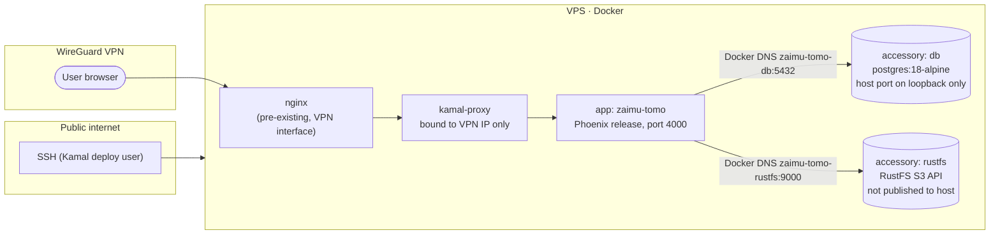

# Deployment

How ZaimuTomo runs in production and how to ship a new version. For the "why",
see [architecture.md §7](architecture.md#7-deployment-view). For runbooks
(migrations, recovery, backups), see [operations.md](operations.md).

> **No secrets or host details here.** Real hostnames, IPs, ports reserved on
> the host, credentials, and the reverse-proxy config live outside git (in
> `.kamal/secrets`, the operator's password manager, and the VPS itself). This
> page only names the variables.

## Topology



Key properties:

- **Kamal 2** (`config/deploy.yml`) builds an `amd64` image from `Dockerfile`, pushes it to GHCR, and runs it on one host over SSH.
- **Network exposure:** kamal-proxy binds only to the VPN interface (`KAMAL_PROXY_BIND_IP`) on a non-standard port, because nginx already owns port 80. nginx on the VPN interface forwards to kamal-proxy. Nothing is published on the public interface except SSH. TLS is off (`proxy.ssl: false`, no `FORCE_SSL`) because traffic stays inside WireGuard.
- **Accessories:** Postgres and RustFS run as Kamal accessories on the same host, reachable from the app through Docker DNS. Postgres's host port is bound to loopback only (for local admin). RustFS publishes no host port.
- **Watchtower** runs on the VPS for other containers. Every Kamal-managed container has the label `com.centurylinklabs.watchtower.enable=false`, so only Kamal changes them.
- **Deploy user:** a dedicated SSH user (default `kamal`), key-only, in the `docker` group, with no sudo. Docker group membership is effectively root, so the protection comes from isolation and SSH hardening, not confinement.
- **Health:** kamal-proxy polls `GET /health` (and the image has a Docker `HEALTHCHECK`). `/up` is an alias. Both sit outside every router pipeline.

## The image

`Dockerfile` is a two-stage build: `elixir:1.19.4-otp-28` builds the release
(`mix compile`, `mix assets.deploy`, `mix release`), and
`gcr.io/distroless/cc-debian13:debug-nonroot` runs it as UID/GID `65534`,
pinned to match the ownership of the existing uploads volume from the earlier
Debian `nobody` runtime. The distroless debug image supplies BusyBox `sh`
(symlinked to `/bin/sh` for the release scripts) and `wget` for the
`HEALTHCHECK`. Release scripts from `rel/overlays/bin/` are included:

| Script | Purpose |
|---|---|
| `bin/migrate` | Run Ecto migrations. |
| `bin/recover_stuck_documents` | Re-enqueue stuck documents (dry run unless `CONFIRM=true`). |
| `bin/verify_storage` | HEAD every `documents.object_key` in the bucket. |
| `bin/backfill_document_fingerprints` | Fill missing document and journal-entry SHA-256 fingerprints (idempotent, online). Optional arguments: journal entry IDs a human confirmed as file reuses. |
| `bin/migrate_to_s3` | One-off legacy copy from the old upload volume. |

Keep the Elixir/OTP versions in sync across `Dockerfile`, `.github/workflows/ci.yml`, and `.agents/setup`.

## Configuration and secrets

- Non-secret runtime config is in `config/deploy.yml` under `env.clear` (LLM backends and models, S3 endpoint and bucket, TypeSafe tuning, OTel service name).
- Secrets are listed in `env.secret` and `.kamal/secrets.example`. Copy the example to `.kamal/secrets` (git-ignored), or export the variables in your shell before running Kamal. `deploy.yml` uses ERB with `ENV.fetch`, so host values must be present in the environment:

  ```sh
  set -a; source .kamal/secrets; set +a
  ```

- Every variable is described in [configuration.md](configuration.md).

## First-time setup (new host)

1. Prepare the host: install Docker, create the dedicated deploy user, set up the WireGuard interface, and configure nginx on the VPN interface to proxy to kamal-proxy's port (WebSocket upgrade headers are required for LiveView).
2. Locally: install Kamal, then fill `.kamal/secrets` (generate `SECRET_KEY_BASE` with `mix phx.gen.secret`). `DATABASE_URL` points at the accessory (`…@zaimu-tomo-db:5432/zaimu_tomo_prod`).
3. Boot the accessories and the app:

   ```sh
   kamal accessory boot db
   kamal accessory boot rustfs
   kamal setup
   kamal migrate
   ```

4. In the RustFS console (reached through an SSH tunnel, never published), create the bucket named by `S3_BUCKET` **with versioning and Object Lock enabled**. Object Lock cannot be added after creation.
5. Check the app over the VPN, and run `kamal verify_storage`.

## Routine deploy

```sh
set -a; source .kamal/secrets; set +a
kamal deploy
kamal migrate        # when the release contains migrations
```

Notes:

- Kamal performs a zero-downtime switch at the proxy. In-flight Oban jobs on the old container are rescued by `Oban.Lifeline` after 30 minutes, if they don't finish during shutdown.
- Migrations run *after* the new container is live, so write migrations that the previous release can run against (additive first, destructive later).
- Kamal aliases (`config/deploy.yml` → `aliases`) are invoked directly: `kamal console`, `kamal migrate`, `kamal db_rollback`, `kamal verify_storage`, `kamal recover_stuck_documents`, `kamal backfill_document_fingerprints`, `kamal migrate_to_s3`.

## CI

GitHub Actions (`.github/workflows/ci.yml`) runs on pushes to `main` and on every
PR, for any base branch so stacked PRs are covered. It compiles with warnings as
errors, migrates a Postgres 18 service, and runs `mix test`. CI does **not**
deploy. Deploys are manual with Kamal from the operator's machine. Dependabot
opens grouped dependency bumps.
