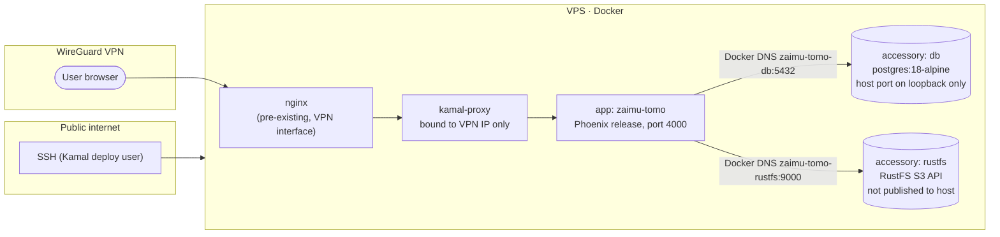
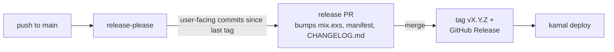

# Deployment

How ZaimuTomo runs in production and how to ship a new version. For the "why",
see [architecture.md §7](architecture.md#7-deployment-view). For runbooks
(migrations, recovery, backups), see [operations.md](operations.md).

> **No secrets or host details here.** Real hostnames, IPs, ports reserved on
> the host, credentials, and the reverse-proxy config live outside git (in
> `.kamal/secrets`, the operator's password manager, and the VPS itself). This
> page only names the variables.

## Topology



Key properties:

- **Kamal 2** (`config/deploy.yml`) builds an `amd64` image from `Dockerfile`, pushes it to GHCR, and runs it on one host over SSH.
- **Network exposure:** kamal-proxy binds only to the VPN interface (`KAMAL_PROXY_BIND_IP`) on a non-standard port, because nginx already owns port 80. nginx on the VPN interface forwards to kamal-proxy. Nothing is published on the public interface except SSH. TLS is off (`proxy.ssl: false`, no `FORCE_SSL`) because traffic stays inside WireGuard.
- **Accessories:** Postgres and RustFS run as Kamal accessories on the same host, reachable from the app through Docker DNS. Postgres's host port is bound to loopback only (for local admin). RustFS publishes no host port.
- **Watchtower** runs on the VPS for other containers. Every Kamal-managed container has the label `com.centurylinklabs.watchtower.enable=false`, so only Kamal changes them.
- **Deploy user:** a dedicated SSH user (default `kamal`), key-only, in the `docker` group, with no sudo. Docker group membership is effectively root, so the protection comes from isolation and SSH hardening, not confinement.
- **Health:** kamal-proxy polls `GET /health` (and the image has a Docker `HEALTHCHECK`). `/up` is an alias. Both sit outside every router pipeline.

## The image

`Dockerfile` is a two-stage build: `elixir:1.20.0-otp-28` builds the release
(`mix compile`, `mix assets.deploy`, `mix release`), and `debian:trixie-slim`
runs it as `nobody`. Release scripts from `rel/overlays/bin/` are included:

| Script | Purpose |
|---|---|
| `bin/migrate` | Run Ecto migrations. |
| `bin/recover_stuck_documents` | Re-enqueue stuck documents (dry run unless `CONFIRM=true`). |
| `bin/verify_storage` | HEAD every `documents.object_key` in the bucket. |
| `bin/backfill_document_fingerprints` | Fill missing document and journal-entry SHA-256 fingerprints (idempotent, online). Optional arguments: journal entry IDs a human confirmed as file reuses. |
| `bin/migrate_to_s3` | One-off legacy copy from the old upload volume. |

Keep the Elixir/OTP versions in sync across `Dockerfile`, every job in `.github/workflows/*.yml`, and `.agents/setup`.

## Configuration and secrets

- Non-secret runtime config is in `config/deploy.yml` under `env.clear` (LLM backends and models, S3 endpoint and bucket, TypeSafe tuning, OTel service name).
- Secrets are listed in `env.secret` and `.kamal/secrets.example`. Copy the example to `.kamal/secrets` (git-ignored), or export the variables in your shell before running Kamal. `deploy.yml` uses ERB with `ENV.fetch`, so host values must be present in the environment:

  ```sh
  set -a; source .kamal/secrets; set +a
  ```

- Every variable is described in [configuration.md](configuration.md).

## First-time setup (new host)

1. Prepare the host: install Docker, create the dedicated deploy user, set up the WireGuard interface, and configure nginx on the VPN interface to proxy to kamal-proxy's port (WebSocket upgrade headers are required for LiveView).
2. Locally: install Kamal, then fill `.kamal/secrets` (generate `SECRET_KEY_BASE` with `mix phx.gen.secret`). `DATABASE_URL` points at the accessory (`…@zaimu-tomo-db:5432/zaimu_tomo_prod`).
3. Boot the accessories and the app:

   ```sh
   kamal accessory boot db
   kamal accessory boot rustfs
   kamal setup
   kamal migrate
   ```

4. In the RustFS console (reached through an SSH tunnel, never published), create the bucket named by `S3_BUCKET` **with versioning and Object Lock enabled**. Object Lock cannot be added after creation.
5. Check the app over the VPN, and run `kamal verify_storage`.

## Releases

Versions and release notes come from the conventional commits on `main`, through
[release-please](https://github.com/googleapis/release-please)
(`.github/workflows/release-please.yml`, configured in
`release-please-config.json`, current version in `.release-please-manifest.json`).



1. Every push to `main` updates one open release PR, titled `chore(main): release X.Y.Z`. It bumps `version` in `mix.exs` and the manifest and prepends the new section to `CHANGELOG.md`.
2. Merge it when you want to ship. The next run tags `vX.Y.Z` on the merge commit and publishes a GitHub Release with the same notes.
3. Deploy that commit (below). The sidebar shows `Application.spec(:zaimu_tomo, :vsn)`, so the running version is visible in the app.

Version rules while below 1.0 (`bump-minor-pre-major`): `feat` and breaking changes (`!` or a `BREAKING CHANGE:` footer) bump the minor version; `fix`, `perf`, `refactor`, and `revert` bump the patch. `docs`, `test`, `ci`, `build`, `chore`, and `style` are hidden from the changelog and never open a release PR on their own. This is the only prose copy of `changelog-sections` in `release-please-config.json`; change both together. Non-conventional subjects, such as `Merge pull request …`, are ignored. To force a version, add a `Release-As: X.Y.Z` footer to a commit.

Requirements and caveats:

- The repository setting "Allow GitHub Actions to create and approve pull requests" (Settings → Actions → General) must stay on; the workflow uses the default `GITHUB_TOKEN`.
- PRs opened with `GITHUB_TOKEN` don't trigger other workflows, so CI does not run on the release PR. Its diff only touches version strings and `CHANGELOG.md`. If you need checks on it, close and reopen it yourself.
- `v0.1.0` is a baseline tag on the last commit before release-please. `bootstrap-sha` in the config marks the same commit, so earlier history never appears in the changelog.
- Never edit the version, the manifest, or `CHANGELOG.md` by hand; change the commits (or use `Release-As:`) instead.

## Routine deploy

```sh
set -a; source .kamal/secrets; set +a
kamal deploy
kamal migrate        # when the release contains migrations
```

Notes:

- Kamal performs a zero-downtime switch at the proxy. In-flight Oban jobs on the old container are rescued by `Oban.Lifeline` after 30 minutes, if they don't finish during shutdown.
- Migrations run *after* the new container is live, so write migrations that the previous release can run against (additive first, destructive later).
- Kamal aliases (`config/deploy.yml` → `aliases`) are invoked directly: `kamal console`, `kamal migrate`, `kamal db_rollback`, `kamal verify_storage`, `kamal recover_stuck_documents`, `kamal backfill_document_fingerprints`, `kamal migrate_to_s3`.

## CI

GitHub Actions (`.github/workflows/ci.yml`) runs on pushes to `main` and on every
PR, for any base branch so stacked PRs are covered, as three jobs: `lint` (format
check, blocking `mix credo --strict`, unused-dependency check), `test` (compiles
with warnings as errors, migrates a Postgres 18 service, runs `mix test`), and `security-audit`
(`mix hex.audit`, advisory/non-blocking — a new CVE in an unrelated dependency
shouldn't block unrelated work). A separate scheduled workflow
(`.github/workflows/nightly-audit.yml`) re-runs `mix hex.audit` nightly, since
that's the only way to catch a CVE disclosed on a day with no pushes at all. CI
does **not** deploy. Deploys are manual with Kamal from the operator's machine.
`.github/workflows/release-please.yml` runs on pushes to `main` and only manages
the release PR, tags, and GitHub Releases (see [Releases](#releases)).
Dependabot opens grouped dependency bumps.

A separate scheduled workflow (`.github/workflows/nightly-dialyzer.yml`) runs
`mix dialyzer` nightly, with its PLTs cached under `priv/plts` (keyed on the
installed OTP/Elixir versions and `mix.lock`, rebuilt only when one of them
changes). The `deps`/`_build` caches use the same version prefix, so a cache
built by another toolchain is never restored. Advisory, not a required
check: Dialyzer's whole-program success typing is a complementary, slower
check that doesn't gate pushes. Opaque-type checks are off (`flags: [:no_opaque]`
in `mix.exs`, see D31 in architecture.md). Other known tool/stdlib false positives are
suppressed in `.dialyzer_ignore.exs`, each with a comment explaining why it's
benign — re-verify them after any Ecto, Elixir, or OTP upgrade.

A separate PR workflow (`.github/workflows/rubric-review.yml`) runs an advisory
LLM critic (`mix zaimu_tomo.rubric_review`, `continue-on-error: true`, reusing
the same Elixir/OTP cache key as `ci.yml`) against the path-matched rubrics in
`.rubrics/*.yaml` when the `RUBRIC_LLM_API_KEY` repository secret is configured
(with optional `RUBRIC_LLM_BASE_URL` and `RUBRIC_LLM_MODEL` repository
variables), posting or updating one sticky comment on the PR. Schema validation
of `.rubrics/*.yaml` runs inside `ci.yml`'s `mix test` (`ZaimuTomo.RubricsTest`),
and the critic job skips immediately when `RUBRIC_LLM_API_KEY` is unset. See
[`.rubrics/README.md`](../.rubrics/README.md).

All jobs in all five workflows pin `runs-on: ubuntu-26.04` rather than
`ubuntu-latest`, so a GitHub image migration can't silently change the toolchain
under a green build. Bump the label deliberately, in one commit, when a newer
image is worth adopting.
